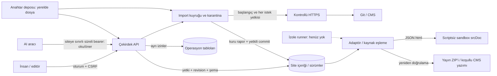

# Studio V2 tehdit modeli

Tarih: 2026-11-06. Kapsam: mevcut yerel alfa ve barındırılan profilin hedef sınırları.
Bu belge bir sızma testi veya güvenlik sertifikası değildir.

## Varlıklar ve aktörler

Korunanlar: kullanıcı oturumları, kurum/site yetkileri, kaynak ve taslaklar, eşlemeler,
karantina verisi, bağlantı sırları, geçmiş sürümler, rezervasyon/ödeme kayıtları ve yedekler.
Tehdit aktörleri: diğer kurum, yetkisi azaltılmış kullanıcı, zararlı kaynak/arşiv sahibi,
prompt injection içeren kaynak, ele geçirilmiş bağımlılık, sızmış sağlayıcı anahtarı,
hatalı/zararlı AI aracı ve kaynak tüketimini hedefleyen istemci.

## Veri akışı

Mevcut içerik ve operasyon tabloları aynı SQLite ve uygulama sürecindedir.
Şema/rol ve süreç izolasyonu uygulanmış değildir. V2 preview bir HTML servis origin'i
değil JSON yanıtından iframe srcDoc'tur; legacy /preview yolu farklıdır.
Hosted nesne deposu, ayrı preview origin'i, KMS ve worker kesikli/hedef sınırlardır.

## Kontrol ve kanıt matrisi

| Sınır / tehdit | Uygulanan kontrol | Kanıt | Açık / hedef |
|---|---|---|---|
| Tarayıcı → API; CSRF/oturum | Oturum çerezi, CSRF, giriş sınırı | test/security.test.mjs; v2/http.test.mjs | Hosted MFA, kurum SSO |
| Kurum → başka kurum verisi | Kaynak/site üyeliği; sorguda site kapsamı | cross-tenant ve content-only HTTP testleri | PostgreSQL yapısal tenant sınırı |
| Kuyruk → kaynak; eski yetki | Başlangıçta ve her uzak isteğin öncesi/sonrası güncel yetki ve revision | E-04 HTTP testleri | Dağıtık worker iptal ve yetki olayı |
| İptal edilen üyelik → karantina | Queued/analyzing/review sonuçlarını temizleme; aktif isteği abort | E-04 queued/active/staged testleri | Diğer süreçte anlık iptal henüz yok |
| ZIP/Git → kaynak yolları | Ortak NFC/case kimliği, özgün yolu koruma, boyut ve bağlantı reddi | import-hardening; Git duplicate HTTP testi; contracts ZIP testi | Daha geniş arşiv/fuzz korpusu |
| URL → ağ; SSRF/DNS rebinding | Tüm DNS cevaplarını kontrol, seçilen IPv4'e pin, HTTPS/port sınırı, redirect reddi | network.test.mjs | Testler taklit transport; gerçek ağ/pentest değil |
| Kaynak → önizleme; aktif kod | Scriptsiz opaque sandbox, inert HTML/CSP | contracts önizleme; ui/main.tsx | Ayrı origin doğrudan URL tarayıcı testi; legacy ayrı inceleme |
| Alan → kaynak; XSS/şema atlama | Ortak validRich/validateDocument ve adaptör politikası | contracts, HTTP manual/AI XSS | Geniş XSS korpusu ve bağlantı politikası |
| Geçmiş → restore/render/export | Güncel şema/alan kontrolü, adaptörle yeniden keşif, parmak izi ve belge eşitliği | snapshots.test.mjs; corrupted history HTTP testi | Otomatik şema dönüşümü yok; uyumsuzluk reddedilir |
| Editör ↔ dış yazar | Revision CAS, stale source reddi, WP koşullu yazma | concurrency, reimport ve WP HTTP testleri | Üç yönlü birleştirme, re-anchoring |
| İçerik geçmişi → operasyon | Restore yalnızca studio_sites/studio_versions/audit yazar | restore preserves booking HTTP testi | Ayrı DB rolü; gerçek N-1 geri alma denemesi |
| Sır → yayın/istemci | Kurum/türe bağlı AES-GCM zarfı, DEK wrapping, eski kayıt uyumu, API'de sır dışlama | envelope ve WP/legacy credentials HTTP testleri | Gerçek KMS, toplu rotasyon, log/geniş sızıntı korpusu |
| AI → çekirdek | Hash'i saklanan süreli/siteye sınırlı anahtar; oku/öner allowlist; insan fark/onayı; aynı save/validation | E-16 HTTP yetki/iptal/süre/kötü çıktı; tarayıcı onay denemesi | Sağlayıcı veri politikası yok; eski actorType kullanıcı beyanıdır |
| Bağımlılık → uygulama | Lockfile, lisans, scriptsiz kurulum, CycloneDX ve commit'e sabit CI | licenses; sbom; audit; 1ecad8d Windows/Ubuntu başarılı | Runner paket proxy'si ve OS/action envanteri |
| Yedek → geri dönüş | Offline SQLite, ayrı şifreli anahtar parçası, set/hash eşleşmesi, yeni hedefe restore | migration ve secure-backup testleri | Veri parçası araçta şifrelenmez; hosted PITR, tutarlı online nesne snapshot |
| Sınırsız iş → kaynak tükenmesi | Dosya/yanıt/iş süre-boyut limitleri | contracts ZIP; network stream bound | Kurum kotası, adil kuyruk, CPU/bellek/disk worker limiti |

Her hedef kontrol tamamlanana kadar açık kabul edilir; yalnızca belgeye yazılması
güvenlik kontrolünün uygulanmış olduğu anlamına gelmez.

## Kaynak ve çıktı güven politikası

- Zengin metin alanı küçük izinli gramerle doğrulanır; geçersiz içerik sessizce düzeltilmez.
- Özgün JS/CSS/SVG kaynak dosyası, Studio'ya çalıştırma yetkisi vermez. Kaynak ZIP'i
  özgün kodu korur; indirilen paketin başka sunucuda yayınlanması ayrıca yetkili bir işlemdir.
- SVG normal resim kütüphanesine kabul edilmez; kaynak olarak saklanabilmesi ziyaretçiye
  güvenli sunulduğu anlamına gelmez. Ayrı varlık origin'i/servis politikası açık iştir.
- Veri, içerik veya deponun içindeki AI talimatları yetki kaynağı değildir.
- E-12 mesaj köprüsü eklendiğinde doğru frame ve oturuma bağlanan el sıkışma, nonce,
  mesaj sürümü/boyutu ve komut yetkisi gerekir. Opaque origin'deki null değeri kimlik değildir.
- Script'li preview açılması ayrı güvenlik değişikliğidir; connect-src tek başına
  tüm veri çıkışlarını kapatmaz. Form, frame, img, font, worker ve gezinme politikaları gerekir.

## İşletim ve saklama sınırları

Şu an denetim kaydı veritabanına erişebilen yöneticiye karşı değiştirilemez değildir.
Hash zinciri planlanırsa bağımsız imzalı kontrol noktası/ayrı yazma sınırı da değerlendirilir.
Silme işareti fiziksel silme değildir. İçerik sürümleri, operasyon kayıtları, nesneler,
anahtarlar ve yedeklerin saklama/silme politikaları birlikte tasarlanmalıdır.
