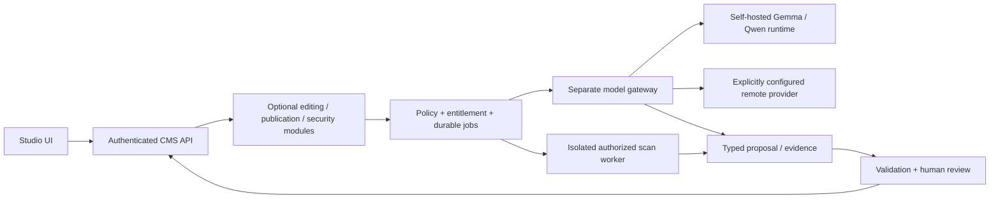

# ADR: optional AI execution outside the CMS process

Owner update, 22 November: [local/open-weight Qwen only](QWEN_DECISION.md).
Remote-provider execution is outside the current rollout; comparative model pilot
steps below are superseded by functional/security acceptance after Qwen4 weights
and license are verified. Independent job/worker architecture remains applicable.

Date: 22 November 2026. Status: proposed implementation architecture; desk analysis
complete, production adoption gated on isolation and evaluation. The job/API/panel and container transport have since been implemented; see
AI_JOB_STORAGE.md and AI_LOCAL_RUNNER.md for delivered controls and remaining gates.

## Existing code and compatibility

`src/v2/agent-access.mjs` already exposes site-scoped document read/proposal creation,
token revocation, current-revision checks and human accept/reject. It permits content,
translations and page SEO strings; it explicitly rejects design/structure changes.
Its tokens/proposals use the current synchronous CMS store. Do not describe this
as an async job service, grant it publication rights, or silently widen its scope.

`packages/module-core/async-host.d.ts` exposes awaited module lifecycle/records/ports.
`trust.mjs` implements trusted-local/reviewed-only loading and explicitly rejects
isolated mode. Current approval is not a sandbox. `async-runtime.mjs` composes this
runtime. Existing integration outbox semantics are useful, but are not a ready-made
GPU queue, remote job lease or commercial entitlement system.

## Decision and topology

Keep the existing modular CMS; build AI execution as independently deployable units.
Do not split unrelated CMS code into microservices just for this feature.

The inference runtime never receives admin cookies, SQL access, production secrets,
arbitrary shell tools or publication credentials. Gateway and scan worker do not
share an unrestricted process/network boundary. UI plugins are trusted Studio code;
third-party executable extensions need separate isolation before installation.

## Package and API boundaries (proposed names)

| Unit | Owns | Must not own |
| --- | --- | --- |
| `@loft-studio/ai-contracts` | Versioned JSON schemas, capabilities and error envelopes | Provider SDKs, SQL or model weights |
| `@loft-studio/ai-jobs` | Scoped durable records, leases, outbox, budgets and cancellation | Inference inside transactions |
| `studio-ai-gateway` service | Model routing, normalized usage, approved endpoint adapters | Business writes and automatic permission escalation |
| Editing/publication modules | UI and scoped proposal workflows | Raw model-dependent APIs in the CMS core |
| Security assessment module/worker | Authorized targets, bounded scanner execution, evidence | Unrestricted browser/shell or production admin session |
| Entitlement adapter | Server-verified feature/usage rights | Replacing user/site authorization |

Use JSON Schema and the existing validation stack for wire contracts; an HTTP API
looking OpenAI-compatible is not capability compatibility. Probe structured output,
tool-proposal parsing, cancellation and image support per pinned runtime/model.
Model selection uses capabilities and measured task fit, not provider-specific
branches in booking/CRM/editor modules. Render availability honestly in module UI.

## Proposed contract and state machine

Job input v1: server-resolved tenant/site/environment/actor, operation kind,
base revision, immutable artifact hashes, allowed target IDs, capability requirements,
region/retention policy, max input/output tokens, deadline and idempotency key.
Do not accept raw destination URLs or a caller's asserted tenant authority.

States: queued → leased → running → review → accepted/rejected; execution may end
failed/cancelled. Separate inference completion from applying content and publishing.
Persist lease owner, expiry, attempt number and fencing token. Ignore stale worker
results after lease replacement/cancellation. Recover after restart with bounded
retry; remote timeouts have unknown usage until reconciled, not assumed zero cost.

Results v1: job/attempt, model/runtime revision, typed content proposal or report,
source revision/digests, evidence references, normalized usage and uncertainties.
Unknown fields/tool names fail closed. Do not persist private chain-of-thought;
store concise findings, evidence and decisions needed for audit.

Reserve quota atomically before dispatch; remote work runs after transaction commit.
Finalize charge idempotently by job+attempt and reconcile provider usage. Recheck
authorization, module status, entitlement and source revision before applying results.
Cancellation prevents application of late results; it cannot guarantee provider
compute or billing already incurred has stopped. Disable prevents new jobs and
retains prior content/reports under normal retention/access policy.

## Security and storage decisions

Reuse async storage API for new job metadata on SQLite and PostgreSQL. Large inputs
and outputs use scoped immutable artifacts; do not load a whole site into prompts.
Cache only within tenant, model revision, source digest and permission context;
invalidate on edits/revocation and never share prompt caches across tenants by default.

Workers use authenticated short-lived job-scoped service credentials, not broad
agent tokens. Runtime endpoints are deployment-configured, authenticated and
network-allowlisted. A local/private model endpoint needs an explicit trusted
deployment connector, never an exception to URL-import SSRF rules. Prevent silent
remote fallback or region changes. Model developer nationality does not determine
where inference data is processed; region/retention are explicit settings.

For scan jobs require verified target authority, allowed hosts/ports/methods,
timeouts, request quotas, stop controls, sandboxed filesystem and constrained egress.
Use deterministic tools for evidence, with LLM triage/explanation as assistance.
Security reports distinguish verified findings from model suggestions; do not sell
automated output as independent pentest certification.

## Delivery sequence and acceptance

1. Build contracts and synthetic evaluation fixtures/runner; no model required.
2. Implement durable jobs with SQLite/PostgreSQL lease, quota, audit and crash tests.
3. Add isolated gateway worker and one pinned runtime adapter; test fake-provider
   malformed JSON, timeouts, cancel races, forbidden tools and cross-tenant access.
4. Run bounded real-model pilot under an explicit hardware/budget configuration;
   record results using AI_MODEL_COMPARISON.md. Keep all failed trials.
5. Ship content-only editing module through existing proposal review, behind a flag.
6. Add commercial activation/metering before paid rollout. Publication assistance
   prepares validated releases; actual publish remains the existing authorized action.
7. Add design proposals under a new explicit permission/schema, then separately
   gated active security assessment. Never bypass today's content-only restrictions.

Release gates include revocation while a job runs, duplicate delivery, stale revision,
worker restart/fencing, quota races, provider partial failure, unsafe output, secret
redaction, retained data after module disable and normal editing with all AI disabled.

Rejected: embed inference in platform.ts (resource/trust coupling); one monolithic
agent with shell/admin access (unbounded authority); model-first downloads before
fixtures (unmeasurable benefit); mandatory cloud inference (unnecessary data transfer).
Tradeoff: separate workers add deployment/queue operations and latency. Revisit the
design after pilot measurements; do not claim existing modules are already sandboxed.
