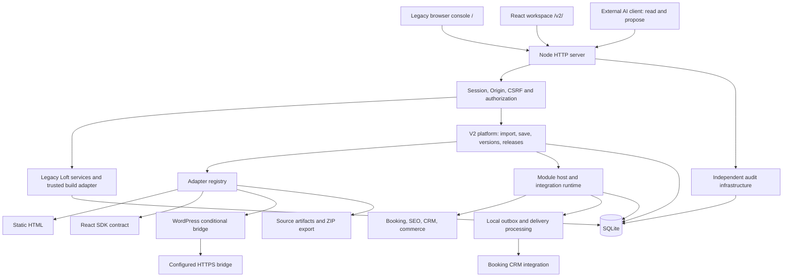
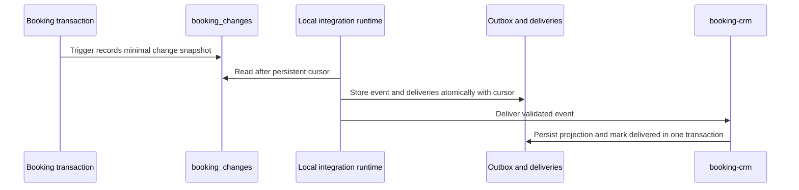

# Loft Studio Technical Architecture and AI Handoff

Updated delivery: 22 November 2026, branch `v2`; implementation baseline `abebb07` plus the visual-selection/component-binding delivery described below. Immutable test evidence is in VERIFICATION.md.
Originally prepared: 17 November 2026; revised: 22 November 2026.
Repository: https://github.com/rasim21-maker/.studio
Application package: `site-admin-console@2.0.0-alpha.1`.

This document describes the implemented local alpha, its code organization, contracts, operational boundaries, and remaining work. It is intended for an AI coding system or engineer receiving this repository for the first time. It is a technical map, not a claim that the hosted product or every planned feature is complete. Paths below are relative to the repository root.

## Current extension surfaces (22 November 2026)

- Current model policy: `QWEN_DECISION.md` supersedes comparative model selection.
  Local/open-weight Qwen only; await verified Qwen4 weights/license, no cloud API.
  Comparative performance benchmark deferred; functional/security tests retained.

- `src/v2/manual-mapping.ts`: fingerprint-bound plain-text leaf selection; commit revalidates against quarantined source.
- `src/v2/selection-preview.ts`, `shared/v2/selection-protocol.ts`, `ui/visual-selection.tsx`: inert source preview plus one nonce-authorized first-party controller in an opaque-origin iframe. Messages change pending selection only. Normal previews remain script-free.
- `src/v2/framework-discovery.ts`: non-executing dependency/HTML evidence, including discovery failures. Detection does not confer edit capabilities.
- `src/v2/component-bindings.ts`, `packages/sdk/components.mjs`: React SDK component prop declarations, validated on import/write. No arbitrary JSX rewriting or imported component execution in Studio.
- `src/v2/github-publications.ts`, `hosting.ts`, `hosting-providers.ts`, `static-deploy-agent.ts`: durable publication and bounded provider/agent connections. See their documents for ambiguity, reconciliation and live-acceptance limits.
- Read root `SECURITY.md` first for the shared human/AI contributor contract. `docs/v2/SECURITY.md` retains the detailed import/preview boundary notes. No independent security signoff is implied.
- Optional AI modules are scoped in `AI_MODULES_PLAN.md`. Durable job storage, authorized review API/panel and trusted connector orchestration are implemented (see `AI_JOB_STORAGE.md`); isolated model execution, entitlements and billing remain pending.
- `AI_MODEL_COMPARISON.md` and `ADR_AI_EXECUTION.md` complete the desk analysis and evaluation design. `AI_EVALUATION.md` documents preview contracts and an offline synthetic evaluator; durable jobs and lease recovery are implemented; isolated model execution remains next. No actual inference results exist yet.

## 1. Product purpose and current position

Loft Studio started as a local administration console for the Loft Pet House website. It is evolving into a technology-independent CMS and website management platform: connect a site, discover editable content, edit it visually, manage business modules, preview changes, and export or publish through a compatible adapter.

Whether a site was written by a human or generated by AI is irrelevant to the supported operations. Its source structure, declared bindings, adapter, credentials, and permissions determine what Studio can do. Studio cannot safely edit arbitrary applications without an integration contract.

The long-term product direction is an open-source core with optional commercial modules, global adoption, and both local and hosted operation. The exact product license has not been selected. First-party packages are currently private workspaces; they are not published npm products. Do not assume that a public GitHub repository or permissively licensed dependencies settle the application's license.

### Implemented foundation

- An authenticated Node HTTP application and persistent SQLite storage.
- The original Loft console alongside a React V2 workspace.
- Static HTML, React SDK, and WordPress bridge adapter contracts.
- Bounded import, revision-aware editing, immutable content versions and releases.
- Shared client/server field validation and dictionaries.
- Drag/keyboard section ordering, responsive layouts, rich text, HTML editing, and image upload.
- Eight independent first-party packages, including business modules, SDK, integration support, and audit logging.
- Booking/CRM communication through durable local events.
- Restricted AI proposal access with human acceptance.
- Local backup/key-management tools and a bounded Python development assistant.

### Not yet a delivered hosted platform

Full CMS PostgreSQL/hosted isolation, object storage, external workers, arbitrary framework build isolation, a module marketplace, paid-module billing and broad live-provider acceptance remain future work. Async modules and booking/payment storage have SQLite and real PostgreSQL acceptance. The default local installation still uses SQLite. GitHub write-back and four bounded hosting connectors are implemented; fixtures/local agent tests are not live-provider acceptance.

## 2. Architecture at a glance



The application is a modular monolith. There is no Express, Next.js server, ORM, Python application backend, or mandatory external queue in this implementation.

The diagram is logical: runtime services share one Node process by default, but CMS, module and operational authorities are separated. Async storage supports SQLite/PostgreSQL for modules and operations; the CMS console store remains SQLite. Package boundaries are not operating-system isolation.

## 3. Technology and build model

| Area | Current implementation |
| --- | --- |
| Runtime | Node.js >=24.13.0 and <25, ESM |
| Server | Native node:http, JavaScript .mjs plus directly imported TypeScript |
| Database | SQLite CMS; async SQLite/PostgreSQL module and operational contracts (see ASYNC_MODULES.md and OPERATION_STORAGE.md) |
| V2 UI | React 19.3.1 and TypeScript 5.9.3 |
| Browser build | esbuild 0.28.2 |
| Rich text | Tiptap |
| HTML source editor | CodeMirror |
| Drag and drop | dnd-kit |
| Schema validation | Ajv, generated standalone validator, shared semantic validation |
| HTML mapping | parse5 |
| ZIP handling | fflate for V2 import-related work; inspect src/zip.mjs for legacy export |
| Regional metadata | countries-list |
| Tests | Node test runner; Python unittest for the development helper |
| Package structure | npm workspaces under packages/ |

Versions are pinned in package.json and package-lock.json. Treat the lockfile as authoritative for transitive dependencies.

`scripts/build-v2.mjs` generates the standalone schema validator, portable document JSON Schema, React fixture lock data, and browser bundle. The server imports TypeScript under the supported Node runtime; `tsc --noEmit` checks types independently.

Generated outputs include `public/v2/app.js`, its CSS/legal outputs, `public/v2/index.html`, `shared/v2/schema-validator.js`, `docs/v2/document.schema.json`, and `src/v2/sdk-lock.ts`. Change their source inputs and rebuild instead of hand-editing generated bundles.

## 4. Repository map

| Path | Responsibility |
| --- | --- |
| src/start.mjs | Environment-based startup, listen address, setup URL, shutdown |
| src/server.mjs | Application composition, HTTP routing, session/CSRF integration, legacy console, V2 dispatch |
| src/store.mjs | SQLite wrapper, legacy schema, seed and transactional operations |
| src/auth.mjs | Password policy, hashing, verification and tokens |
| src/captcha.mjs | reCAPTCHA verification |
| src/federation.mjs | Google, Microsoft, Apple and Facebook login/linking flows |
| src/features.mjs | Legacy/business HTTP feature routing and service composition |
| src/booking.mjs | Compatibility re-export of the extracted booking engine |
| src/integrations.mjs | Payment and live-data providers |
| src/design.mjs, src/structure.mjs | Legacy design and page-structure behavior |
| src/adapters/loft.mjs | Trusted adapter for the original Loft website |
| src/adapters/build-worker.mjs | Legacy trusted build execution; not a general imported-code sandbox |
| src/v2/platform.ts | V2 schema, authorization, imports, sites, save, versions, media, releases, modules |
| src/v2/adapters.ts | Generic adapter implementations and registry |
| src/v2/import.ts | Source/file/archive inspection and media validation |
| src/v2/network.ts | Restricted remote transport for V2 connectors |
| src/v2/render.ts | V2 preview/rendering support |
| src/v2/snapshots.ts | Historical snapshot compatibility and validation |
| src/v2/fixtures.ts | Explicitly labelled local adapter examples |
| src/v2/sdk-template.ts, sdk-lock.ts | Independent React example and its pinned dependency contract |
| src/v2/regional-settings.mjs | Country, language, currency and time-zone preferences |
| src/v2/agent-access.mjs | AI credentials and proposals |
| src/security/ | Runtime-file exclusions, local wrapping keys and envelope encryption |
| src/audit.mjs | Loft-specific wiring, authorization, routes and table registration for audit |
| shared/v2/model.ts | Document, source, layout, adapter and permission types; theme/template registry |
| shared/v2/schema.ts | Declarative JSON Schema |
| shared/v2/validation.ts | Shared semantic, dictionary, HTML, URL and cross-field checks |
| ui/main.tsx | Workspace, import UI, site editor and main dialogs |
| ui/editors.tsx | Reusable editing controls |
| ui/module-panel.tsx | Schema-driven business module management |
| ui/integration-panel.tsx | Generic related timeline integration view |
| ui/agent-panel.tsx | AI credential/proposal interface |
| ui/regional-panel.tsx | Regional configuration |
| ui/audit-panel.tsx | Filtered audit browser, details and downloads |
| public/ | Legacy frontend and generated V2 frontend |
| packages/ | First-party SDK, infrastructure and business packages |
| studio.config.mjs | Trusted deployment-time module/integration composition |
| scripts/ | Build, checks, backups, dependency evidence, package consumer tests, development helper |
| test/ | Legacy regressions |
| test/v2/ | V2 contracts, HTTP, security controls, module and audit regressions |
| test/dev-assist/ | Python helper tests |
| vendor/ | Vendored project inputs; inspect the Loft adapter and notices before modifying |
| docs/v2/ | Current architecture and implementation documentation |
| docs/security/, docs/traceability.md, docs/delta-durum.md | Threat model, requirement evidence and staged implementation tracking |

Ignored runtime directories include `data/`, `test-results/`, `.dev-assist/`, and `node_modules/`. Real environment files are ignored; `.env.example` is a template.

## 5. The legacy and V2 applications coexist

### Legacy console

The root URL `/` serves the original Loft administration UI. It uses a fixed Loft content/language schema, per-language drafts, structure settings, trusted build input, authenticated previews, and downloadable static packages. It also exposes operational booking/calendar/provider management.

Legacy content authority lives in tables such as `drafts` and `structures`. Its model is not the generic V2 Document model. Existing Loft drafts have not been copied into a competing V2 content store.

### V2 workspace

`/v2/` serves the React workspace for generic connected sites. Its authority is `studio_sites.document` plus the corresponding source representation and immutable versions. The legacy Loft console remains reachable for compatibility.

V2 sites can be connected to the existing operational subsystem using their UUID. This compatibility arrangement reuses booking/payment storage; it does not mean the old Loft content editor has been converted to the generic editor.

Keep this distinction when migrating features. A fix to the V2 preview or validator does not automatically fix its legacy counterpart.

## 6. Startup and request composition

`createApp(...)` in `src/server.mjs` is the testable composition root. It accepts project/data paths, origin, security dependencies, a module factory, and integration definitions.

Startup broadly performs:

1. Validate the configured origin and prepare the data/build directories.
2. Initialize the trusted Loft adapter and SQLite store.
3. Seed the legacy site and construct operational features.
4. Create the V2 platform, additive tables, module host and integration processing.
5. Attach audit infrastructure after the underlying application tables exist.
6. Configure CAPTCHA and identity federation.
7. Provide one-time setup if there are no users.
8. Return the server and lifecycle resources to the startup script or tests.

The first administrator uses a random, single-use setup URL valid for 30 minutes. There is no default username/password. The startup script handles SIGINT/SIGTERM through application close.

The HTTP wrapper records request lifecycle events. Protected routes resolve the current session, apply required Origin/CSRF rules, and derive scope from current database memberships. V2 operations recheck authorization and revisions around asynchronous boundaries where needed.

## 7. Persistence model and authority

The default database is `data/console.sqlite`. Content, operational records, and logs share the database but have separate logical ownership.

| Table family | Purpose |
| --- | --- |
| users, sessions, attempts | Local users, hashed session lookup, persistent rate-limit state |
| external_identities, oauth_transactions | Linked provider identities and short-lived federation transactions |
| sites, memberships | Legacy/operational site identity and roles |
| drafts, structures, history, builds, events | Legacy content, structure, changes, immutable build inputs and events |
| studio_orgs, studio_workspaces, studio_projects | Generic organizational hierarchy |
| studio_sites | Site identity, adapter, environment, revision, document and source |
| studio_members | Site-scoped permission list |
| studio_versions, studio_releases | Immutable content versions and release references |
| studio_imports | Import progress, staged result, idempotency and expected revision |
| studio_connections | One persisted remote connection per site, configuration and sealed secrets |
| studio_audit, studio_migrations | Existing V2 domain audit and schema history |
| studio_agent_tokens, studio_ai_proposals | Restricted AI credentials and human-reviewed suggestions |
| studio_module_installations | Module version, schema version, state and lifecycle revision |
| studio_module_records, studio_module_events | Scoped collection records and module events |
| studio_event_cursors, studio_event_outbox, studio_event_deliveries | Source progress and durable local integration delivery |
| studio_integration_records, studio_integration_record_versions | Integration-owned records with monotonic revisions |
| studio_integration_references | Durable cross-module deletion protection |
| booking/payment/calendar tables | Operational records owned by their services; inspect booking engine and integrations schema |
| studio_log_entries, studio_log_migrations | Independent request/change/event log and its schema version |
| studio_log_operators, studio_log_settings | Installation audit access and one-time bootstrap state |

Some settings tables are created by their feature service rather than `src/store.mjs`. Do not treat that file as a complete schema catalog.

The hierarchy is organization → workspace → project → site → environment. Current imports create a development environment arrangement; arbitrary environment promotion is not implemented.

Source text files and media bytes are held in SQLite JSON representations. Media is base64 encoded and content-addressed. This local bounded model is not an S3 store.

### Invariants

- Derive tenant/site access from the authenticated actor, not a client-provided organization identifier.
- Use expected revisions on mutations; reject stale updates rather than silently overwriting.
- A content restore must not rewind reservations, payments, customers, or integration history.
- Each data authority must be unambiguous; a manifest cannot make operational records part of source history.
- Preserve stable bindings and IDs across reviewed reimport.
- Do not equate an organization owner, a legacy site admin, and an installation audit operator.

## 8. Generic document and validation contract

`shared/v2/model.ts` defines Document schema version 2:

```text
Document
  schemaVersion, name, locale, locales
  theme: preset, font, radius
  pages[]
    id, name, path, title, description
    layout: desktop, tablet, mobile
    sections[]
      id, name, kind, enabled
      fields[]
      layout: desktop, tablet, mobile
  dictionaries[]
```

Section kinds are source, text, hero, image, CTA, booking and gadget. Fields support text, rich text, URL, image, number, boolean and enum, with applicable required/min/max/maxLength/step/dictionary/translation constraints.

Layout supports stack/grid/flex, columns, gap, padding, margin, maximum width, horizontal/vertical alignment, text justification and auto-alignment. Current shared bounds include spacing 0–160 px, 1–4 columns, and width 320–1920 px. There are 12 theme presets and seven layout presets. These are token/layout presets, not a third-party theme marketplace.

Three layers matter:

1. Declarative JSON Schema checks the representation.
2. Shared semantic validation checks rich HTML, URLs, dictionary membership, field rules and relationships.
3. Adapter validation prevents edits that cannot be safely mapped to the source.

Client validation provides immediate feedback. Server validation is authoritative. Imports, manual edits, AI acceptance and historical snapshots must not bypass it.

Dictionaries have stable IDs, localized labels, aliases, active state and versions. Strict dictionaries constrain values; suggestion dictionaries do not reject arbitrary free text. Historical use of inactive values is preserved. An interactive unknown-value import mapping UI and general spelling service are not implemented.

Module SDK fields are a separate business-record schema, not aliases of Document fields. SDK fields additionally include email, date, datetime, reference, items, uniqueness and collection relationships. Preserve that distinction when building shared controls.

## 9. Adapter and source contracts

An Adapter implements `id`, `version`, `discover`, `capabilities`, `validate`, `write`, `preview`, `export`, and optionally conditional `publish`.

- Discovery produces a document, normalized source and warnings.
- Capabilities report supported, partial or unsupported with reasons.
- Write maps an accepted model edit back into source bytes.
- Preview produces an isolated representation.
- Export produces source artifacts, not necessarily a built/deployed application.
- Publish is optional and requires an authenticated compatible connection.

The core owns permissions, local revisions and transactions. Adapters own source-specific behavior. Add adapters through the registry rather than adding site-type conditions throughout the core.

A Source holds UTF-8 files, media assets, permanent bindings and a manifest. A binding connects a document field/section to an actual source file and tag/attribute.

### Static HTML

parse5 source locations and `data-studio-page`, `data-studio-id`, `data-studio-field` identify editable regions. Discovery is deliberately limited to safely mapped structures. Unknown source remains intact.

Existing sections can be reordered/hidden. Arbitrary nested framework rewrites, deletion of existing source sections, and generic new-page creation are not universally supported. A visual drag must persist through adapter.write, not merely mutate the preview DOM.

### React SDK

Compatible applications consume `studio/content.json` and `studio/design.css`. Optional `studio/components.json` declares versioned component-to-field bindings; `@loft-studio/sdk/components` resolves safe primitive props for developer-owned React components. See COMPONENT_BINDINGS.md. The Northstar example has its own pinned React build pipeline. Other React applications need to consume this contract or supply an adapter. Studio does not execute imported JSX in its preview.

### WordPress

The bridge requires HTTPS endpoints of the form:

```text
GET /wp-json/loft-studio/v1/pages/:id
    -> { html, revision }
PUT /wp-json/loft-studio/v1/pages/:id
    If-Match: previous opaque revision
    body: { html }
    -> new revision
```

The remote bridge must atomically enforce the expected revision and page-scoped authorization. Standard WordPress REST alone does not provide this custom bridge. Local fixtures test the protocol; a production WordPress plugin/deployment has not been accepted. Do not flatten Gutenberg blocks, shortcodes or page-builder structures without an explicit supported mapping.

### Manifest example

```json
{
  "manifestVersion": 2,
  "adapter": {"id": "react-sdk", "version": 1},
  "name": "Example",
  "contentPath": "studio/content.json",
  "locales": ["en", "tr"],
  "connections": [{"id": "source", "kind": "files", "authority": ["code", "content", "design"]}],
  "preview": {"mode": "sdk"},
  "publish": {"mode": "export"}
}
```

The manifest can express several connections, but the current persisted connector table supports one remote connection per site. Do not mistake the model's intended expressiveness for complete storage support.

## 10. Import and source drift

Import follows select → authorize → quarantine/inspect → discover/map → validate/report → commit.

Supported entry points include local examples, ZIP sources, GitHub snapshots and the conditional WordPress bridge. Jobs persist state/progress but execution is local to the application, not an external durable worker service.

Important controls include relative paths, Unicode/case collision checks, limits on archive expansion and file count, rejection of links/nested archives, file-content validation, and secret/runtime-file exclusions. Representative UI limits are 8 MiB ZIP, 24 MiB expansion and 800 files; implementation limits in `src/v2/import.ts` take precedence.

Imports never run package installation scripts or arbitrary source code. The inspection report is not a security certification.

V2 remote transport validates destinations and resolved IPs, pins checked addresses, restricts response size/time, and rejects unsafe destinations/redirect behavior. Do not extend this guarantee to every legacy provider request without examining that transport.

Import idempotency uses owner/request key plus an input fingerprint. Reimport checks the expected local revision and preserves site identity. Authorization is rechecked during remote work; cancellation/revocation must prevent later commit.

GitHub imports snapshots and supports immutable commit preparation, expected-source checks, non-forced branch updates and durable publication reconciliation. There is no automatic conflict merge. See GITHUB_PUBLICATION.md and HOSTING.md. Exports include `studio/source-state.json` to preserve bindings and hashes. Hash mismatch rejects a stale mapping; hashes establish consistency, not authenticity.

## 11. Save, preview, release and restore flows

### Save

Browser draft → schema/semantic feedback → PUT document with expected revision → current authorization → adapter validation/write → transaction updating document/source/revision → immutable version and domain audit → response.

Business-record and content edits use their respective contracts. Avoid bypassing these through direct UI-specific writes.

### Preview

V2 previews run in an opaque-origin sandbox without executing imported scripts or passing administrator credentials. Preview fidelity is intentionally limited for applications requiring runtime JavaScript. Original scripts/styles are preserved in export sources; preview safety does not justify stripping source artifacts.

The legacy preview has a different CSP and trusted build model. Do not claim that V2 preview isolation applies to it.

### Release/export

Release records reference immutable content versions. Snapshot validation runs again before export/download/publication. ZIP generation is not hosting deployment.

### Restore

Historical documents and bindings must pass current validation before activation. Invalid or incompatible restore leaves active content unchanged. Restoring content never restores an older operational database.

## 12. Module SDK and host

Eight workspaces currently exist:

| Package | Role |
| --- | --- |
| @loft-studio/sdk | Module/integration definitions, shared field validation, TypeScript declarations, CLI |
| @loft-studio/module-core | Registry, lifecycle, scoped records, transactions, migrations, integrations |
| @loft-studio/booking | Independent booking engine and Studio compatibility wrapper |
| @loft-studio/seo | Metadata records, apply-to-page command, audit, sitemap/robots output |
| @loft-studio/crm | Companies, contacts, opportunities and activities |
| @loft-studio/commerce | Catalog, stock and administrator-created orders |
| @loft-studio/booking-crm | Optional integration requiring both modules |
| @loft-studio/audit | Independent infrastructure logging |

A module definition declares manifest ID/version/API version/schema version/permissions/dependencies/services; collections; commands; ordered migrations; and optional install/export/event hooks.

`ctx.records` is scoped to site/module/declared collection. Updates/deletes require revisions. Records are schema validated, uniqueness is scoped, and relationships protect referenced records. `beforeSave` output is validated again.

Current API 2 uses awaited storage transactions and asynchronous scoped record/event operations. Keep provider/network I/O outside transaction locks. The API 1 synchronous SQLite host remains a compatibility surface, not the contract for new modules. See ASYNC_MODULES.md, OPERATION_STORAGE.md and packages/module-core/async.mjs.

Installation states are enabled, disabled and uninstalled. Disable/uninstall preserve data. Dependencies prevent unsafe shutdown. Migration failure rolls back the affected lifecycle change; silently downgrading to an older schema is not permitted.

`studio.config.mjs` is the trusted composition point. The module factory receives existing services and returns module definitions; `studioIntegrations` holds independent integration definitions.

External developer start:

```sh
node packages/sdk/cli.mjs create ./my-module acme.notes
node packages/sdk/cli.mjs check ./my-module/index.mjs
npm run test:packages
```

The check command loads trusted local JavaScript. It is not a scanner for unknown packages. Modules share the process and can execute Node code; declared service scopes are an API contract, not a malicious-code sandbox.

## 13. Business modules

### Booking

The engine lives in `packages/booking/engine.mjs`; `src/booking.mjs` is a compatibility re-export. It supports overnight and timed services, capacity, resources, working periods, blocking calendar entries, pricing/currency, cancellation limits and revision-aware changes. Generic participants coexist with legacy pet data.

Idempotent requests bind a request ID to canonical request content. Reusing an ID with changed input is a conflict. Older records lacking provable request fingerprints are preserved, but ambiguous repetitions are rejected.

A standalone consumer need not have payment tables. Payment-aware deployments inject `hasPaymentLock(siteId, bookingId)` into the booking engine. Created/processing/paid/review payments block rescheduling through that port.

Disabling booking blocks new operational writes while preserving history and necessary existing cancellation/payment-finalization channels.

### Payments and live data

`src/integrations.mjs` contains iyzico, Stripe and PayPal integrations and weather/news/stock/index/traffic services. Credentials and provider readiness are explicit. Local fixtures are not live payment acceptance.

Keep amount, currency, provider verification, idempotency and reconciliation decisions on the server. Do not infer successful payment from a browser redirect alone. Provider code has not all been extracted into independent packages.

Calendar supports recurring events and ICS export; this is not bidirectional Google/Outlook synchronization.

### CRM

Companies, contacts, opportunities and activities are persistent. Email uniqueness and relationships are checked; sales summaries respect currency. Marketing consent is stored data, not an email campaign engine.

### Commerce

Administrator-created orders use server-side catalog prices, atomic stock changes, idempotency, line-item snapshots and single stock restoration on cancellation. The initial package leaves payment state unpaid. A public storefront/cart/checkout, tax/shipping, refunds and invoicing are not implemented.

### SEO

Metadata can be applied through the normal revisioned page API. Sitemap/robots are generated for download and separate publication. Canonical/hreflang, redirects, structured data and automatic deployment hooks remain gaps.

## 14. Booking CRM integration and event delivery

The booking and CRM packages do not directly depend on one another's UI. `@loft-studio/booking-crm` declares the relationship through `defineIntegration`.

Both modules must be enabled and version-compatible. When either is unavailable, related UI and integration API access disappear; records remain. Booking continues independently when CRM is disabled.

Users explicitly link one reservation to a CRM contact. Similar names/emails never authorize automatic identity merging. Linking does not automatically create a lead, change consent or send messages.



The runtime polls locally every second, processing bounded batches. Failed handlers roll back their writes and retry with increasing delay, up to five attempts. Failed deliveries remain visible and can be requeued by an authorized user.

Handlers must tolerate repeat delivery. The booking projection deduplicates by reservation/source revision and prevents older events from regressing current state. There is no general exactly-once external side-effect or total ordering guarantee.

Integration-owned reference indexes survive disabled or removed code and protect linked records from deletion. Background handlers do not inherit arbitrary user session access. General integration schema migration is not yet provided.

## 15. Independent audit module

`packages/audit` is an infrastructure package, wired by `src/audit.mjs`. It remains active when business modules are disabled.

It captures:

- Accepted HTTP request start, completion or abort, including static/failed requests.
- UTC time, request UUID, verified actor, method/path, response status and duration.
- Socket/derived IP with provenance.
- Client-reported User-Agent, browser/OS hints and language.
- Registered data mutations with safe resource identity and before/after field differences.
- Log viewing and export activity.

AsyncLocalStorage correlates operations with their request. Legacy SQLite request/business tracking uses connection-local temporary triggers; API 2 module and operational writes use asynchronous atomic audit/outbox paths and idempotent projection into the existing audit query store. Log failure aborts that business transaction. Request-start logging failure rejects the request; a failure after sending the response can only raise a safe operational alarm.

Passwords, tokens, cookies, authentication material and sensitive payment fields are excluded/masked. Raw request bodies and query strings are not indiscriminately copied. Binary/source values and oversized structures use explicit omission markers/digests. Logs are not full data backups.

Default IP attribution trusts the socket. Only explicitly configured proxy IPs may contribute a validated forwarded chain. Client metadata does not establish MAC address, serial number, hostname or verified physical identity.

Access is separated into account/site/organization scopes and installation operators. V2 read/export permissions are `audit` and `auditExport`. Initial setup grants the first operator; an existing installation bootstraps the earliest Loft admin once. Additional operator IDs can be configured. Removing an ID from environment configuration does not itself revoke its persisted role.

The UI is available through “İşlem kayıtları” and `/v2/#audit`. JSON/CSV exports use stable pagination, recheck access during streaming and enforce bounded time/size. CSV formulas are escaped. Interrupted/revoked exports fail rather than pretending to be complete.

Ordinary SQL update/delete protection is not cryptographic/WORM assurance against a database administrator. There is no automatic retention deletion. Pre-install requests cannot be reconstructed; external writers without installed capture triggers are outside coverage. Audit attachment occurs after startup migrations/seed.

## 16. Authentication, secrets and AI trust boundaries

Local passwords use scrypt. Session cookies are HttpOnly/SameSite Strict, with Secure and a host-prefixed name under HTTPS. Session tokens are hashed in storage. Writes use Origin and CSRF protections. Rate limits persist; password changes invalidate other sessions.

Federation supports configured Google/Microsoft/Apple/Facebook flows. Linking requires an existing authenticated account and relevant verification. Matching email addresses do not automatically merge users or grant membership.

New V2 connector secrets use AES-256-GCM envelope encryption: a per-secret data key is wrapped separately and bound to organization/type context. The default wrapping provider uses a protected local vault file. It is not a cloud KMS. Older key formats remain necessary for older records and backups.

AI credentials are expiring, revocable, site-specific bearer tokens. Only these public agent operations are exposed:

```text
GET  /api/v2/agent/sites/:siteId/document
POST /api/v2/agent/sites/:siteId/proposals
```

Proposals carry expected revision and document. Allowed changes are constrained to content fields/translations and SEO text. Schema, dictionaries, layout, members, payments, import and publication are not granted.

Human acceptance reuses normal validation/save and records the proposer and approver. Token revocation rejects pending proposals. No LLM provider is automatically called. A legacy client-supplied actorType is provenance text, not verified agent identity.

## 17. HTTP surface map

This is a navigation index, not a replacement for exact request/response code and tests.

| Route family | Responsibility |
| --- | --- |
| /api/auth/*, /auth/:provider/callback | Local/federated authentication and callback handling |
| /api/identities/* | External account linking/unlinking |
| /api/sites/:site/* | Legacy documents, structure, membership, builds and operational services |
| /preview/:site/:build/* | Authenticated legacy build preview |
| /api/v2/imports/* | Import jobs, review, commit and cancellation |
| /api/v2/sites/:site | Site summary/document/source metadata |
| .../document, .../validate | Revisioned save and validation |
| .../preview, .../source | Preview and read-only source inspection |
| .../connection/check | Remote source drift check |
| .../history, .../diff, .../restore | Content history and restoration |
| .../releases, .../releases/:id/download | Immutable release and export |
| .../media, .../members | Media upload and membership |
| .../publish | Optional conditional provider publication |
| .../regional, .../regional-options | Regional preferences/options |
| .../agent-tokens, .../ai-proposals/* | Human administration of AI access |
| .../extensions | Authorized module catalog |
| .../extensions/:module/install or enable/disable/uninstall/upgrade | Module lifecycle |
| .../extensions/:module/collections/:collection | Collection CRUD |
| .../extensions/:module/commands/:command | Typed module command |
| .../extensions/:module/export | Authorized preserved-data export |
| .../extension-links/:integration/commands/:command | Integration commands |
| .../extension-links/:integration/status or retry | Delivery health/retry |
| /api/audit/scopes, /api/audit/events, /api/audit/export | Independent audit access |

Common failure categories include 401 for missing authentication, 403 for denied scope/CSRF, 409 for revision/idempotency conflicts, 422 for invalid domain data, and explicit provider/readiness errors. Inspect each handler rather than inventing one universal response envelope.

## 18. Frontend workflow and accessibility

The V2 editor has a page/layer/component/media sidebar, central preview, selected-item properties, and save/history/publish controls. Device overrides, theme/layout presets, HTML/rich-text controls and shared validation drive model edits.

Autosave tracks the draft and revision. Conflicts expose differences rather than silently overwriting. Undo/redo is editor state history; persisted content restoration is a separate server operation.

Module forms and lists derive from SDK definitions. Integration timelines derive from declared views rather than hardcoded CRM/booking branches.

Keyboard alternatives and responsive views are implemented and tested in selected flows. No blanket WCAG 2.2 AA certification is established. Turkish is prominent in the current interface; country preferences do not imply complete interface translation.

## 19. Local setup and configuration

From a checkout of branch v2:

```powershell
npm.cmd ci --ignore-scripts
npm.cmd run build
npm.cmd start
```

Use npm instead of npm.cmd outside Windows. Supported runtime is Node 24.13+ within 24.x.

Default address is `http://127.0.0.1:4317`. The origin must match exactly; localhost and 127.0.0.1 are not interchangeable for Origin/cookie behavior.

Key environment settings are PORT, HOST, APP_ORIGIN and DATA_DIR. The template also lists CAPTCHA, identity-provider and audit proxy/operator configuration. Never paste real values into handoff documents, commits or AI prompts.

An external origin requires HTTPS-related configuration and CAPTCHA. Node itself is not a complete production TLS/reverse-proxy deployment. One instance per data directory is the documented local operating model.

## 20. Backup, migration and recovery

Schema changes are additive and versioned. Preserve working legacy columns/data during the compatibility window.

`scripts/secure-backup-v2.mjs` provides offline backup, verify and restore. It separates data and encrypted key material and binds the pieces with manifest hashes. The data portion itself is not encrypted by that utility; protect it with encrypted storage/access controls.

Restore targets must be new directories. Verify backups and reconcile booking/payment state against an explicit recovery point before use. Do not restore an old operational database as a routine way to roll back application code.

Exact N-1 reader/writer compatibility, managed KMS rotation, online snapshots and point-in-time recovery are not fully delivered. Consult OPERATIONS.md and MIGRATION.md before touching actual data.

## 21. Tests and verification evidence

The older November 17 baseline had 54 legacy plus 112 V2 tests. The November 22 pre-picker delivery reached 231 application tests. Consult VERIFICATION.md and the current worktree-bound dev-assist report for this delivery; do not reuse historical counts as current evidence. The delivery gate includes Python helper tests and eight-package consumer checks. One Python symlink test was skipped on Windows. Typecheck, build, consistency checks, licenses, SBOM and dependency audit also passed. These are recorded local results, not a claim about a later GitHub Actions run.

Important suites:

| Suite | Main purpose |
| --- | --- |
| test/pilot.test.mjs, security.test.mjs, features.test.mjs | Legacy behavior, auth and business features |
| test/v2/contracts.test.mjs | Adapter and shared model contracts |
| http.test.mjs | V2 HTTP behavior |
| import-hardening.test.mjs, network.test.mjs | Malformed/unsafe import and destination handling |
| snapshots.test.mjs, migration.test.mjs | Historical compatibility and data preservation |
| envelope.test.mjs, secure-backup.test.mjs | Secret encryption and backup recovery |
| modules.test.mjs, module-http.test.mjs | Lifecycle, scoped records, API and schemas |
| module-integrations.test.mjs | Activation, references, delivery and booking/CRM interaction |
| review-regressions.test.mjs | Previously identified cross-cutting regressions |
| audit.test.mjs | Atomic changes, identities, IP attribution, isolation, export and schema restart |
| test/dev-assist/test_dev_assist.py | Helper boundaries, subprocesses, redaction and report freshness |
| scripts/test-packages.mjs | Real tarball consumers outside application imports |

Full checks:

```powershell
npm.cmd run test:dev-assist
npm.cmd run typecheck
npm.cmd run build
npm.cmd run check
npm.cmd test
npm.cmd run test:v2
npm.cmd run test:packages
npm.cmd run licenses
npm.cmd run sbom
npm.cmd audit
```

CI is configured for Ubuntu and Windows with pinned Actions, locked dependencies and read-only repository permissions. Test databases/keys are not intended CI artifacts.

Use synthetic fixture data. Never point tests at production DATA_DIR. A fixture payment or WordPress bridge proves a contract, not provider deployment.

## 22. Token-efficient development with the Python helper

The helper is developer tooling, not product runtime. It requires Python 3.10+, uses the standard library, and is launched through `scripts/dev-assist.mjs`.

```powershell
npm.cmd run --silent dev:assist -- status
npm.cmd run --silent dev:assist -- context --query "booking crm"
npm.cmd run --silent dev:assist -- run --test test/v2/audit.test.mjs
npm.cmd run --silent dev:assist -- run --profile full
npm.cmd run --silent dev:assist -- summary
npm.cmd run --silent dev:assist -- checkpoint --done "Completed work" --next "Next task"
```

It bounds context/log output, runs allowlisted checks, and records commit/worktree fingerprints under ignored `.dev-assist/`. Read status/stale/not_run/truncation rather than trusting a successful invocation alone.

The helper does not edit files, commit, push, install packages, run arbitrary shell commands, host MCP, or invoke an LLM. Another AI needs its own authorized local tool access to call it. Snapshot freshness does not prove unchanged dependencies, environment or external services.

## 23. How another AI should extend this codebase

1. Read AGENTS.md, this document and the relevant focused contract before changing code.
2. Inspect current Git status and helper evidence. Do not infer clean state or successful tests from this document's historical baseline.
3. Work on v2 unless the owner requests otherwise. Preserve unrelated edits and operational data.
4. Choose the correct extension boundary:
   - Source technology behavior → adapter.
   - Business records/commands → module.
   - Optional cross-module behavior → integration.
   - Cross-cutting request/storage logging → audit infrastructure.
   - Regional preference → regional service, not ad hoc global currency replacement.
5. Add meaningful observable regression coverage. Verify persistence, authorization and absence of unintended writes, not merely function calls.
6. Reuse existing components before adding dependencies. Verify new code's license/version/security, pin it, preserve notices and update the inventory.
7. Run focused tests during iteration and required delivery checks before claiming completion.
8. Explain partial capability/provider acceptance honestly. A disabled placeholder is not a working integration.
9. Record durable architecture decisions in repository docs and short continuation notes through the helper.
10. Keep content rollback, application rollback and disaster recovery as three different operations.

### Common mistakes to avoid

- Treating all imported HTML/React applications as fully editable.
- Calling source ZIP creation a production deployment.
- Assuming the custom WordPress bridge exists on standard WordPress.
- Using document history to restore bookings or payment records.
- Adding booking/CRM-specific branches to generic core/UI instead of an integration definition.
- Calling declared permissions a sandbox for untrusted Node packages.
- Equating a theme color palette with a complete theme/template ecosystem.
- Treating country preferences as automatic legal compliance or data residency.
- Claiming the new audit log reconstructs historical requests or prevents all administrator tampering.
- Assuming a locally passed test proves remote CI or live provider success.
- Removing old keys/columns before proving restoration and compatibility.

## 24. Remaining roadmap boundaries

The main missing capabilities are general visual content-type authoring; a full blog/taxonomy/comment package; general editorial approval and scheduled publishing; reusable dynamic/global components; richer media workflows; complete SEO; public commerce checkout; messaging/CRM automation; calendar synchronization; customer portals; visitor search/analytics; finer module/record/field permissions; and complete module distribution/commercial licensing.

Architecture work still includes hosted storage/repository contracts, structural tenant isolation, external workers, isolated builds, actual CMS bridge implementations, production provider acceptance, and operational recovery maturity.

Existing local outbox delivery, media upload, visual ordering, shared validation, revisions, booking/CRM links and audit logging should not be listed as absent merely because their hosted or advanced versions remain unfinished.

## 25. Reading order and source precedence

Start with these files, then follow the relevant implementation:

1. AGENTS.md and package.json.
2. src/server.mjs and studio.config.mjs.
3. shared/v2/model.ts, schema.ts and validation.ts.
4. src/v2/platform.ts, adapters.ts and import.ts.
5. packages/sdk/index.d.ts and packages/module-core/.
6. The business/integration package being changed.
7. docs/v2/TESTING.md and corresponding tests.

Supporting documents:

- [Architecture](ARCHITECTURE.md)
- [Adapter contracts](ADAPTERS.md)
- [Module contracts](MODULES.md)
- [Integration delivery](INTEGRATIONS.md)
- [Audit operation and limits](AUDIT.md)
- [Import and preview security](SECURITY.md)
- [Backup, secrets and AI operation](OPERATIONS.md)
- [Migration](MIGRATION.md)
- [Product and licensing decisions](PRODUCT_MODEL.md)
- [Verification history](VERIFICATION.md)
- [Local development helper](LOCAL_DEVELOPMENT.md)

Some older documents describe earlier slices. For example, later integration work supplies a local durable outbox even where earlier architecture text lists events as future work. Root README statements about the legacy console do not define V2 media/editor capability. Resolve discrepancies by the specific runtime path, current code and tests; update the affected document rather than silently merging incompatible claims.

This handoff intentionally contains no credentials, customer exports, live database content or local machine-specific secrets.
