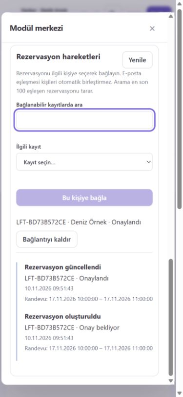

# Modüller arası iletişim ve rezervasyon–CRM

Tarih: 2026-11-10. Kapsam: yerel V2 sürümü; güvenilir sunucu paketleri.
Bu dilim bağımsız CMS, bütün iş otomasyonları veya hosted iş kuyruğu teslimi değildir.

## Kullanım

1. V2 sitesinde Modül merkezi'ni açın. Randevu ve konaklama ile CRM paketlerini kurun/etkinleştirin.
2. CRM → Kişiler içinde bir kişi oluşturun veya mevcut kişiyi açın.
3. Rezervasyon hareketleri alanından rezervasyonu seçip **Bu kişiye bağla** düğmesine basın.
4. Oluşturma, durum ve tarih değişiklikleri zaman çizelgesine otomatik aktarılır.
5. Yanlış bağlantıyı **Bağlantıyı kaldır** ile kaldırabilirsiniz; kişi ve rezervasyon silinmez.

Bir rezervasyon aynı anda tek CRM kişisine bağlanır. E-posta/name benzerliği
otomatik kimlik eşleştirmesi veya kişi birleştirme yapmaz. Yeni kişi/fırsat
oluşturma, lead'i müşteriye dönüştürme, pazarlama izni değiştirme ve bildirim
gönderme bu sürümde otomatik değildir.

## Etkinlik ve yetki sözleşmesi

- İki modülün de etkin ve kurulu sürümlerinin çalışan tanımla uyumlu olması gerekir.
- Bir modül kapalı/kaldırılmışsa CRM'de ilgili panel yoktur; doğrudan entegrasyon
  komutları ve durum uçları da sunucuda reddedilir.
- Kapatma bağlantıları ve hareketleri silmez. Yeniden açılışta bekleyen hareketler
  aktarılır, mevcut bağlantılar geri gelir.
- CRM kapalıyken rezervasyon bağımsız çalışır. Rezervasyon kapalıyken önceki
  iptal/ödeme sonuçlandırma kanalları korunur; bunların değişiklikleri de kuyruğa alınır.
- Her okuma/yazma güncel site üyeliği ve ilgili modüllerin bütün bildirilmiş
  izinlerinden geçer. Bu iki pakette mevcut izin adı operations'tır;
  henüz ayrı booking.read / crm.read kullanıcı rolleri yoktur.
- Kişiyi silme, kapalı veya bileşimden çıkarılmış bir entegrasyonda bile bağlantısı
  varsa reddedilir. Arşivleme mümkündür.
- Modülün mevcut yetkili dışa aktarımı, erişilebilen entegrasyon kayıtlarını da
  içerir; kapalı modüller için geçmiş veri korunur.

## SDK sözleşmesi

defineModule artık sürümlü events sözleşmelerini ve isteğe bağlı eventSource.read
portunu destekler. Mevcut ctx.emit denetim kaydını korur; bildirilmiş iş olayını
aynı savepoint içinde outbox'a da yazar. Salt okunur komut olay yazamaz.

defineIntegration ayrı paketlerde şu alanları bildirir:

- id, name, version, requires (modül kimliği → desteklenen ana sürüm), permissions.
- subscriptions: kaynak modül + olay türü + olay sürümü + senkron handler.
- collections: yalnızca entegrasyonun sahip olduğu şemalı kayıtlar.
- commands: doğrulanmış kullanıcı girdileri ve salt okunur/yazan işlem ayrımı.
- views: bir modül koleksiyonundaki kayıt ekranına eklenen relatedTimeline alanı.

ctx.records site + entegrasyon + koleksiyon kapsamını uygular; güncelleme/silme
beklenen revision ister. Silip aynı kimlikle yeniden oluşturma eski revision'ı
yeniden kullanmaz. Filtreler alan şemasına göre denetlenir ve SQL parametresi olur.
Bu sürümün modüller arası reference alanları yalnızca üst düzeyde desteklenir.
module ve collection ile hedef bildirilir; hedef kimliği aynı sitede, güncel
kullanıcı izniyle doğrulanır. Kalıcı referans indeksi paket kodu kaldırılınca da
silme korumasını sürdürür.

ctx.modules.get yalnızca requires içinde bildirilmiş modüllerin kayıtlarını,
komutu çalıştıran kullanıcının yetkisiyle okuyabilir. Arka plan handler'ı
kullanıcı oturumu almaz ve bu API'yi kullanamaz; sadece kendi entegrasyon
kayıtlarını olay sözleşmesinden üretir.

Yeni entegrasyon studio.config.mjs içindeki studioIntegrations dizisine eklenir.
Çekirdeğe booking/CRM adına göre koşul eklenmedi. Örnek uygulama:
packages/booking-crm/index.mjs. Henüz genel entegrasyon şema yükseltme/migration
API'si yoktur; mevcut v1 alanlarının anlamı uyumsuz biçimde değiştirilmemelidir.

## Kalıcı teslim

Rezervasyon motoru booking_changes tablosuna aynı SQL işlemi içindeki trigger
ile asgari anlık görüntü yazar. Bu, eski/yeni yönetim arayüzünü, ziyaretçi
rezervasyonunu, süre dolmasını ve ödeme doğrulamasının rezervasyon durumuna
etkisini kapsar. Kuyruk e-posta, telefon, notlar, katılımcı bilgileri veya yönetim
token'ı içermez; kişi adı ve rezervasyon referansı yetkili operasyon verisidir.
Olay actor değeri system:booking-storage'dır; bunu insan kimliği saymayın.
Asıl insan/sağlayıcı işlemleri mevcut operasyon denetim kayıtlarında kalır.

eventSource.read(after, limit) artan sequence, siteId, type, data, actor ve
occurredAt döndürür. Kaynak yalnızca güvenilir sunucu kodudur. Yerel işleyici her
saniye en fazla 100 kaynak kaydını cursor ile alır. Kaynak cursor'ı, outbox ve
teslim satırları aynı işlemde kaydedilir. Hatalı kaynak ilerletilmez; diğer
kaynakların alınması ve önceden kuyruğa giren olayların teslimi devam eder.

Her entegrasyon için işlem başına en fazla 100 teslim yapılır. Handler'ın kayıtları
ve teslimin tamamlanma işareti tek SQLite işlemindedir. Hata bu yazımları geri alır;
artan gecikmeyle en fazla beş kez denenir. Başarısız kayıtlar kaybolmaz.
Kişi ekranı bekleyen/başarısız aktarım sayısını gösterir. members yetkili kullanıcı
başarısız teslimleri yeniden kuyruğa alabilir. Hata ayrıntısına paket istisnası
veya sır yazılmaz. Olay şeması teslim sırasında yeniden doğrulanır.

Sözleşme tekrar teslimi mümkün kılar; handler idempotent olmalıdır.
booking-crm, rezervasyon kimliği + kaynak revision ile hareketleri tekilleştirir
ve geç teslim edilen eski sürümün güncel rezervasyon görünümünü geriletmesini
engeller. Bütün entegrasyonlar için tek seferlik dış etki veya kesin sıra
garantisi verilmez. Ağ çağrıları/senkron olmayan işlemler transaction içinde
çalıştırılmamalıdır. Bu güvenilir paket sözleşmesi kötü niyetli Node kodunu
izole eden bir sandbox değildir.

## API ve arayüz

Mevcut GET /api/v2/sites/:site/extensions kataloğu izinli ve etkin views döndürür.
Kişi ekranı modül adlarını bilmeden bu görünüm tanımını kullanır.

- POST /api/v2/sites/:site/extension-links/:integration/commands/:command
- GET /api/v2/sites/:site/extension-links/:integration/status
- POST /api/v2/sites/:site/extension-links/:integration/retry

Bütün POST uçları normal oturum/Origin/CSRF yolunu kullanır.
AI anahtarları bu uçları kendiliğinden kazanmaz.
Arayüz üç saniyede bir yenilenir; modül/yetki kaybında mevcut panel verisini
temizler. Sunucu yetki iptalini sonraki istekte uygular.

Bağlantılar 100'lük, hareketler 50'lik sayfalardır. Hareket görünümü seçili
bağlantı sayfasına aittir. Aday araması en son 100 eşleşen rezervasyonu tarar;
bağlı olanlar seçimden çıkarılır. Tarihler tarayıcının yerel saat diliminde gösterilir.

## Geçiş, sınırlar ve araştırma

Eski rezervasyonlar ilk açılışta bir kez baseline olarak alınır; önceki bütün
durum değişiklikleri yeniden oluşturulmuş gibi gösterilmez. Mevcut id/revision,
istek kimlikleri, ödeme ve müşteri kayıtları değiştirilmez. Eski Loft sitesi
henüz genel V2 site kaydı olmadığından yeni CRM paneli V2 siteleri içindir.

Bu sürüm ayrı bir payment.* olay/tahsilat/iade zaman çizelgesi, harici CRM
eşitlemesi, otomatik müşteri eşleştirmesi veya bildirim motoru sağlamaz.
Kuyruk ve kayıt saklama/temizleme politikası henüz ayrı ürün arayüzüne sahip
değildir. Hosted ayrı worker, ağ/disk/bellek izolasyonu ve PostgreSQL teslim
uyarlaması tamamlanmış değildir.

Mevcut SDK/SQLite ve React altyapısı yeniden kullanıldı. Önceki açık kaynak
araştırmasındaki hook/eklenti sözleşmeleri değerlendirildi; bu yerel senkron
dilim için yeni üçüncü taraf kuyruk veya CMS bağımlılığı eklenmedi. Yeni
booking-crm birinci taraf pakettir, private durumundadır; npm'e yayımlanmadı.

