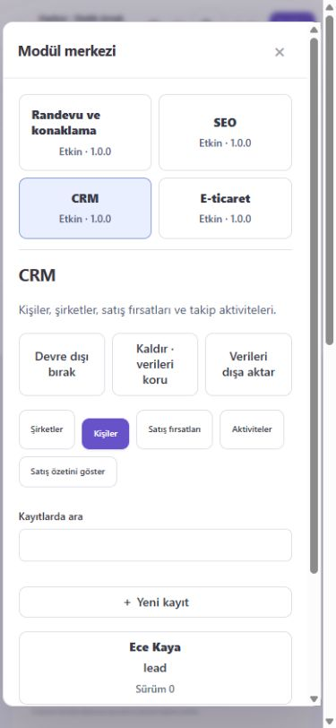

# Modüler çekirdek ve SDK — 0.1

Tarih: 2026-11-09. Bu sürüm, V2 uygulamasına güvenilir sunucu paketlerinin
eklenmesini sağlar. Kurulum yerel/self-hosted çalışma içindir; indirilen keyfi
kodu izole çalıştıran bir mağaza veya hosted sandbox değildir.

## Paketler

| npm paketi | Sorumluluk |
| --- | --- |
| `@loft-studio/sdk` | Bildirim, alan/komut sözleşmesi, tarayıcı ve sunucuda aynı doğrulama, TypeScript türleri, CLI |
| `@loft-studio/module-core` | Paket kaydı, bağımlılıklar, kurulum/etkinlik durumu, veri geçişi, yetki ve siteye bağlı kayıt deposu |
| `@loft-studio/booking` | Mevcut gecelik/saatlik rezervasyon motoru, takvim, kapasite ve uyumluluk kurulumu |
| `@loft-studio/seo` | Metadata kayıtları, normal sürümlü API üzerinden sayfaya uygulama, denetim, sitemap/robots üretimi |
| `@loft-studio/crm` | Şirketler, kişiler, ilişkili fırsatlar/aktiviteler, para birimine göre satış özeti |
| `@loft-studio/commerce` | Ürün, stok ve manuel sipariş; sunucu fiyatlandırması, tekil istek ve iptalde stok iadesi |

Paket sürümü `0.1.0`, ilk modül sözleşmesi `apiVersion:1`, başlangıç modül
veri/işlev sürümü `1.0.0` olarak ayrıdır. Tam sürümler kilit dosyasında sabittir.
Kesin ürün lisansı henüz seçilmediği için paketler `private:true` durumunda
tutulur. Yerel tarball üretimi/testi mümkündür; npm'e yayımlanmadılar. Bu çalışma
ürün veya Loft varlıklarını yeniden lisanslamaz.

## Kurulum ve kullanım

Depo kökünde `npm ci --ignore-scripts`, `npm run build`, `npm start`.
`/v2/` içinde bir site açın ve sol alt menüden **Modül merkezi** seçin.
Bir paketi kurmak/güncellemek için `members` ve paketin bildirdiği izinler
gerekir. İşlevsel kayıtlar `content` veya `operations` izniyle yönetilir.
Formlar, listeler, ilişkili kayıt seçimleri ve komut ekranları paket şemasından
üretilir. UI ve sunucu `@loft-studio/sdk` doğrulamasını paylaşır; sunucu otoritedir.

Yeni güvenilir paketler yalnızca `studio.config.mjs` birleştirme dosyasına eklenir.
Çekirdek paketin adına göre koşul içermez. `createApp({moduleFactory})` aynı
sözleşmeyle farklı paket kümelerinin testini sağlar. HTTP ile paket indirme veya
JavaScript çalıştırma uç noktası yoktur.

## Dış geliştirici akışı

```sh
node packages/sdk/cli.mjs create ./my-module acme.notes
node packages/sdk/cli.mjs check ./my-module/index.mjs
npm run test:packages
```

CLI var olan klasörü ezmez. `check` yalnızca **güvenilir yerel giriş dosyalarını**
yüklemek içindir; yabancı bir paketin güvenlik tarayıcısı değildir.
SDK'nın modül üreticisi şu bildirimi kullanır:

```js
import {defineModule, field} from '@loft-studio/sdk';
export default defineModule({
  manifest: {
    id:'acme.notes', name:'Notes', description:'Team notes',
    version:'1.0.0', apiVersion:1, schemaVersion:1, permissions:['content']
  },
  collections: {
    notes: {label:'Notes', permission:'content', fields:{
      title:field('Title','text',{required:true,maxLength:120})
    }}
  },
  migrations:[{version:1,up(){}}],
  commands:{}
});
```

Kendi paketini bu sözleşmeyle dışa aktar, yerel paket/bağımlılık olarak kur ve
`studio.config.mjs` dizisine ekle. `npm run test:packages` altı paketi tarball
olarak üretir, temiz bir tüketici klasörüne çevrimdışı kurar, SDK CLI ile farklı
bir modül oluşturur ve çekirdeğin uygulama dosyalarını kullanmadan çalıştırır.
Import çözümlemelerinin tüketici klasöründen çıktığını ayrıca denetler.

## Veri ve işlem sözleşmesi

`studio_module_installations`, `studio_module_records`, `studio_module_events`
tabloları eklenir. Kayıt anahtarı site + modül + koleksiyon + kayıt kimliğidir.
Her erişim kimliği doğrulanmış aktörden site yetkisini tekrar türetir; istemcinin
gönderdiği kurum kimliğine güvenilmez. Sıralama/sayfalama/arama ve ilişki kontrolü
aynı kapsam içinde yapılır. Bilinmeyen alanlar ve uygunsuz sözlük değerleri
reddedilir. Tekil alanlar işlem kilidi altında denetlenir.

`ctx.records` yalnızca modülün bildirdiği koleksiyonları sunar. Özel komutlar
çoklu yazımlarını `ctx.transaction()` içinde yapmalıdır. İşlemler ve veri
geçişleri senkrondur; ağ çağrısını SQLite işlemi içinde bekletmeyin. Olaylar
kalıcı olarak kaydedilir; bu sürümde arka plan olay dağıtıcısı bulunmaz.
`beforeSave` sonrasında alanlar ve ilişkiler yeniden doğrulanır.

Güncelleme ve silmede `revision` zorunludur. İlişkili kaydı silme engellenir.
Kapatma/kaldırma veriyi silmez; okuma ve dışa aktarma korunur. Yeniden kurulum
kimlikleri korur. Veri geçişi başarısızsa kayıtlar ve kurulum sürümü aynı işlemde
geri alınır. Eski paket sürümüne sessizce düşülmez; etkin bağımlısı olan paket
kapatılamaz. İçerik sürümünü geri almak operasyon kayıtlarını geri almaz.

Sunucu paketleri güvenilir kod olarak aynı süreçte çalışır. SDK kapsamı ve servis
bildirimleri uygulama sözleşmesidir; kötü niyetli Node koduna karşı OS izolasyonu
değildir. İncelenmemiş modüller kurulmaz. Gerçek sandbox, ağ/sır izin uygulaması
ve kaynak kotası sonraki hosted aşamasına aittir.

## HTTP sözleşmesi

Taban: `/api/v2/sites/:site/extensions`.

| Yöntem / yol | İşlem |
| --- | --- |
| GET `/` | İzinlere göre paket/alan/komut kataloğu |
| POST `/:module/install`, `/enable`, `/disable`, `/uninstall`, `/upgrade` | Beklenen kurulum revision'ı ile yaşam döngüsü; ilk kurulum `-1` |
| GET `/:module/collections/:collection` | `id` veya `limit`, `offset`, `search` ile okuma |
| PUT `/:module/collections/:collection` | `{id?,revision?,data}` ile oluşturma/güncelleme |
| DELETE `/:module/collections/:collection` | `{id,revision}` ile ilişkileri koruyarak silme |
| POST `/:module/commands/:command` | Bildirilen alan şemasından geçen özel işlem |
| GET `/:module/export` | Kapalı/kaldırılmış modül dahil, yetkili veri dışa aktarımı |

Mevcut oturum ve CSRF kontrolleri bütün HTTP yazımlarına uygulanır. AI bearer
erişimi bu uçları otomatik kazanmaz; mevcut insan onaylı AI akışı değişmez.

## Paket kapsamları ve sınırlar

**Randevu:** `src/booking.mjs` artık geriye uyumlu yeniden dışa aktarımdır;
asıl motor pakettedir. Mevcut ayarlar/kayıtlar başka tablolara kopyalanmaz.
Eski rezervasyon ve ziyaretçi ödeme akışları aynı motoru kullanır. Modül kapalıysa
yeni rezervasyon, ayar ve etkinlik yazımı engellenir; geçmiş kayıtlar, mevcut
rezervasyon iptali ve ödeme sonuçlandırma kanalları korunur. Ödeme/veri
sağlayıcılarının tamamı ayrı npm paketlerine henüz çıkarılmadı. Randevu paketinin
depolama portu mevcut operasyon tablolarına uyumludur; özel ödeme sağlayıcılarının
canlı kabul testi önceki sürümde olduğu gibi ayrı gereksinimdir.

Motor bağımsız kullanımda ödeme tablosu beklemez. Ödemeli uygulama
`new Booking(store, {hasPaymentLock:(siteId,bookingId)=>boolean})` ile
senkron bir port sağlamalıdır; Studio bunu Integrations hizmetine bağlar.
Created/processing/paid/review ödeme durumları taşımayı engeller.
Port verilmezse ödeme kilidi yoktur; ödeme kullanan tüketici bunu açıkça bağlamalıdır.
Ziyaretçi iptal yanıtları yalnızca publicView alanlarını içerir.

Rezervasyon istekleri değişmez, anahtar sırasından bağımsız içerik özetiyle
eşleştirilir. Aynı requestId ile farklı veri 409 verir. Eski, özetsiz
isteklerin tekrarları güvenle doğrulanamadığından 409 verir; mevcut
rezervasyonlar okunabilir ve iptal edilebilir. Ayrıntılar MIGRATION.md içindedir.

**SEO:** Metadata kaydını düzenleyip "Metadata taslağını sayfaya uygula" komutuyla
beklenen site sürümüne yaz. Bu işlem olağan adaptör doğrulaması, sürüm ve audit
akışından geçer; ZIP yayını gerçek başlık/açıklamayı içerir. Sitemap/robots
dosyaları indirilir ve ayrıca yayınlanır; otomatik deployment kancası yoktur.
Sitemap dışında bırakmak bir noindex meta etiketi değildir. Canonical/hreflang,
yönlendirmeler ve yapılandırılmış veri sonraki SEO sürümündedir.

**CRM:** Tekil e-posta, şirket/kişi ilişkileri, fırsat aşamaları ve takip aktiviteleri
kalıcıdır. Pazarlama izni bir kayıt alanıdır; e-posta gönderilmez. Kampanya,
otomasyon, toplu import, görsel satış panosu ve harici CRM eşitlemesi yoktur.

**E-ticaret:** Siparişler yönetici tarafından oluşturulur. Sunucu fiyatı ve para
birimini katalogdan alır. Aynı istek anahtarı aynı sonucu döndürür; değiştirilmiş
istek reddedilir. Stok düşümü/sipariş tek işlemde yazılır; iptal stoku bir kez
geri koyar. Sipariş kalemleri ad/fiyat anlık görüntüsünü korur. Ödeme durumu
`unpaid` olarak kalır: sepetli ziyaretçi vitrini, canlı tahsilat, vergi, kargo,
iade ve fatura motoru bu ilk pakette bulunmaz. Diğer paketlerin ticari modüller
olarak lisanslanması veya abonelik tahsilatı henüz uygulanmadı.

SDK şemaları modüllerin içerik modellerini oluşturur; eski sayfa/bölüm modeli
henüz sınırsız bir CMS koleksiyon tasarımcısına dönüştürülmedi. Loft başlangıç
uyumluluğu ve mevcut dağıtım modeli korunmuştur. Paketler ve yeni modül merkezi,
ilerideki çekirdek ayrışmasının çalışan ilk dilimidir.

## Araştırma ve bağımlılık kararı

Mevcut React, doğrulama ve SQLite altyapısı yeniden kullanıldı; yeni üçüncü taraf
çalışma zamanı bağımlılığı eklenmedi. Eklenti sınırları için
[Payload eklenti bileşimi](https://payloadcms.com/docs/plugins/overview) ve
[Strapi sunucu API'si](https://docs.strapi.io/cms/plugins-development/server-api),
paketleme için [npm workspaces](https://docs.npmjs.com/cli/v11/using-npm/workspaces/)
incelendi. Bu projelerden kaynak kod kopyalanmadı. Büyük bir CMS'yi bağımlılık
olarak eklemek mevcut adaptör/operasyon verilerini ikinci bir çekirdeğe bağlayacağı
için seçilmedi. Üçüncü taraf lisans denetimi 120 kilitli bağımlılığı korur;
birinci taraf altı paket ayrıca SBOM'a dahildir.

## Doğrulama

Kalıcı hata matrisi, bağımsız tüketici kabul şartları ve teslim kapıları
[test prosedüründe](TESTING.md) tanımlıdır. Odaklı komut `npm run test:review`;
aynı testler normal `test:v2` ve iki işletim sisteminin CI'ına dahildir.

- `npm run typecheck`, `npm run build`, `npm run check`
- `npm test`, `npm run test:v2`
- `npm run test:packages`
- `npm run licenses`, `npm run sbom`

Yeni testler kapsam/izin, şema, tekillik, ilişkisel bütünlük, sürüm çakışması,
kurulum/kapama/kaldırma, atomik yükseltme geri dönüşü, fiyat/stok/idempotency,
SEO'nun kaynak ve ZIP çıktısı, yeniden başlatma sonrası kalıcılık ve bağımsız
tüketici paket kurulumunu kapsar. Linux ve Windows CI'ına paket testi eklendi.
Yerel tarayıcıda CRM kaydı oluşturma, sipariş kaydı ve stok 8→6 değişimi,
390px genişlikte modül ekranının taşmaması kontrol edildi; konsolda hata görülmedi.


