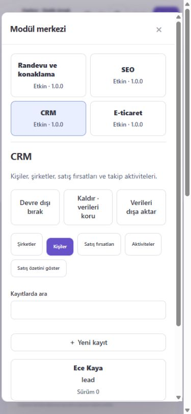
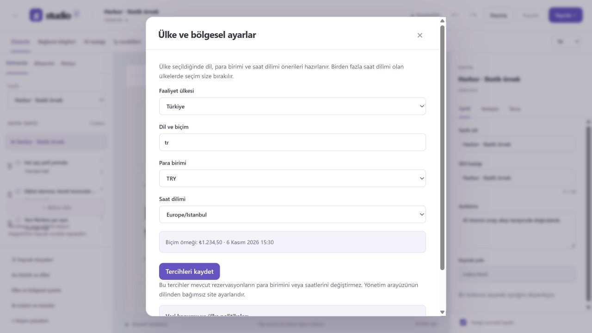
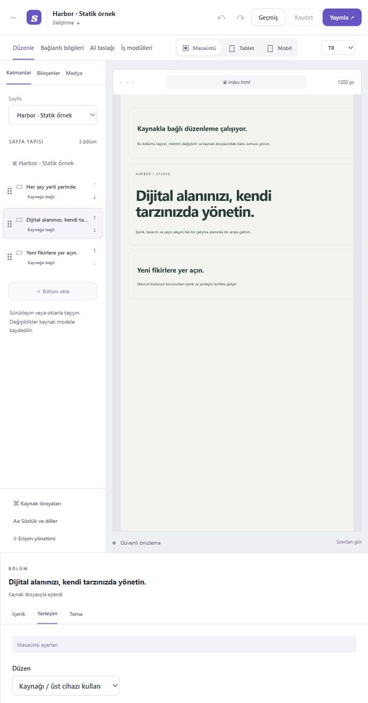

# V2 doğrulama raporu

## 2026-11-09 — Dokuz code review bulgusunun düzeltmesi

R01–R09 düzeltildi. Kalıcı kabul matrisi ve güncellenmiş geliştirme/CI
prosedürü [TESTING.md](TESTING.md) belgesindedir. İlk 14 regresyon testi
düzeltmeden önce ilgili ürün hataları nedeniyle başarısız oldu, düzeltmelerden
sonra geçti. Body okunurken rezervasyon alımının kapanması için eklenen
15. test de önce hatayı gösterdi; güncel durum denetimiyle düzeltildi.

| Kontrol | Gözlenen sonuç |
| --- | --- |
| `npm run test:review` | 15/15 geçti; dokuz bulgu ve bekleyen işlem kapanışı |
| `npm test` | 54/54 geçti; son operasyon route değişikliğinden sonra ilgili 21 HTTP/özellik testi ayrıca yeniden geçti |
| `npm run test:v2` | 88/88 geçti; toplam 142 ayrı test, skip/iptal yok |
| `npm run test:packages` | Altı tarball temiz tüketicide geçti; SDK harici modülü ve ödeme tablosu olmadan randevu oluşturma/taşıma/takvim/iptal akışı |
| `npm run typecheck`, `build`, `check` | Başarılı; 200 kaynak hash'i, 11 dil ve 286 alan/dil korundu |
| `npm run licenses` | 120 kilitli üçüncü taraf bağımlılık; inceleme bekleyen 0 |
| `npm run sbom` | CycloneDX 1.5, 126 kilitli bileşen |
| `npm audit --json` | 2026-11-09: bildirilen açık 0 |

Sır dosyası adı politikası import, snapshot doğrulama ve şifreli yedek
işleminde ortaklaştırıldı. Müşteri iptal yanıtı publicView alanlarıyla
sınırlandı. Operasyon yetkisi body okumasından sonra yeniden denetleniyor;
import commit güncel iş durumunu aynı yazma işlemi içinde okuyor.

Randevu motoru ödeme tablosuna doğrudan bağımlı değil; ödeme kilidi uygulama
tarafından enjekte ediliyor ve mevcut Stripe HTTP testi kilidin çalışmasını
doğruluyor. Modül kapatma yeni işleri engellerken token ile geçmiş erişimi,
iptal ve mevcut ödeme doğrulamasını koruyor. Kapalı katalogda yeni checkout
formu da gösterilmiyor. Aynı istek kimliği farklı rezervasyon içeriğiyle
yeniden kullanılamıyor. Alt dizindeki statik/SDK sayfalarının medya yolları
gerçek export konumuna göre hesaplanıyor. SDK ve arayüzde sıfır değerli
maxLength/maxItems sınırları korunuyor.

Veri geçişi yalnızca booking_requests.fingerprint kolonu ekler. Eski
özetsiz istekler yeniden gönderilirse 409 döner; mevcut rezervasyonlar
silinmez. Geri dönüş ve daha önce import edilmiş sır dosyaları için
[geçiş notlarını](MIGRATION.md) uygulayın. Üretim verisine bu çalışma
sırasında geçiş uygulanmadı.

Sonuçlar yerel Windows/Node 24.13.0 doğrulamasıdır. Build, paket tüketici ve
SBOM komutları Windows sandbox alt süreç kısıtı (EPERM) nedeniyle izinli
çalıştırmayla tamamlandı. CI yapılandırması Ubuntu ve Windows'ta aynı
regresyon/paket kapılarını çalıştıracak şekilde güncellendi; bu kayıt uzak
CI çalışması veya yayın kanıtı değildir. Ödeme sağlayıcıları kontrollü
yanıtlarla test edildi; canlı sağlayıcı veya yeni tarayıcı kabul testi
yapıldığı iddia edilmez.

## 2026-11-09 — Modüler çekirdek, SDK ve dört iş paketi

`v2` dalında altı yerel npm workspace paketi eklendi: SDK, module-core,
booking, SEO, CRM ve commerce. Mevcut rezervasyon motoru bağımsız pakete
taşındı; eski veri tabloları ve çağrılar uyumluluk katmanıyla korunuyor.
Paket sözleşmesi, geliştirici akışı ve sınırlar [MODULES.md](MODULES.md)
belgesindedir. Bu sonuçlar yerel doğrulamadır; bu değişikliklerin uzak CI
çalışması veya npm yayını olarak değerlendirilmemelidir.

| Kontrol | Gözlenen sonuç |
| --- | --- |
| `npm test` | 54/54 geçti |
| `npm run test:v2` | 73/73 geçti; toplam 127 regresyon/sözleşme testi |
| `npm run test:packages` | Altı tarball temiz tüketici projesine kuruldu; harici SDK modülü uygulama kaynaklarına erişmeden çalıştı |
| `npm run typecheck`, `build`, `check` | Başarılı; 200 kaynak hash'i, 11 dil, 286 alan/dil korundu |
| `npm run licenses` | 120 kilitli üçüncü taraf bağımlılık, 95 kurulu paket; inceleme bekleyen 0 |
| `npm run sbom` | CycloneDX 1.5; kilitli 126 bileşen, altı birinci taraf paket dahil |
| `npm audit --json` | 2026-11-09: bildirilen açık 0; güvenlik garantisi değildir |

Yeni test kanıtları: yetki/kurum sınırları, ortak alan doğrulaması, tekillik,
ilişki ve sürüm çakışmaları; paket bağımlılıkları ve sıfır ana sürümlü
bağımlı paketi kapatma koruması; veri kaybetmeden kapatma/kaldırma ve tekrar
kurma; atomik veri geçişi geri dönüşü; salt okunur komuttan yazmanın reddi;
eşzamanlı son stok satışı, sipariş tekrarı ve iptalinde tek stok iadesi;
rezervasyon isteği tekrarında aynı kaydın korunması; SEO değişikliğinin gerçek
kaynağa ve yayın ZIP'ine yansıması; HTTP/CSRF ve yeniden açılış sonrası kalıcılık.

Tarayıcıda ayrı QA hesabı/veritabanıyla CRM kişisi oluşturuldu. İki adet ürün
içeren sipariş kaydedildi, sunucu toplamı 50000 TRY alt birimi ve stok 8→6
olarak görüldü. 390×844 görünümde modül penceresi yatay taşmadı; konsol
hata kaydı boştu. Tam erişilebilirlik veya penetrasyon denetimi yapılmadı.

E-ticaret bu aşamada yönetici siparişleri içindir; ziyaretçi sepeti, canlı
tahsilat, vergi/kargo/iade motoru yoktur. SEO dosyaları indirilip ayrıca
yayınlanır. CRM kampanya veya dış servis eşitlemesi yapmaz. Paketler güvenilir
sunucu kodudur; kötü niyetli eklentiler için sandbox değildir. Kesin ürün
lisansı ve ticari modül yetkilendirme sistemi bu dilimde değiştirilmedi.
Üçüncü taraf çalışma zamanı bağımlılığı veya üretim verisi eklenmedi.

## 2026-11-08 — Uzak CI ve anahtar dosyası adı sertleştirmesi

1ecad8d commit'i için [GitHub Actions çalışması](https://github.com/rasim21-maker/.studio/actions/runs/42454421094)
Windows ve Ubuntu'da bütün adımları başarıyla tamamladı: scriptsiz temiz kurulum,
typecheck/build/check, 54 baseline + 61 V2 testi, lisans, SBOM ve audit.
Her iki işletim sisteminin dependency evidence artifact'ı üretildi.

Son incelemede STUDIO-KEY / .ENV gibi harf büyüklüğü farklı anahtar dosyaları da
şifrelenmeyen veri parçasından dışlandı; anahtar isim çakışmaları reddediliyor.
Bu ek regresyonla yerel V2 paketi **62/62** geçti; toplam kapsam **116** test.
Son düzeltmenin uzak CI sonucu, dalın Actions kaydından ayrıca izlenir.

## 2026-11-07 — Anahtar, AI, ülke tercihleri ve CI dilimi

54 baseline + 61 V2 testi başarılı: toplam **115**. İlk 80 testin tamamı korunur;
bu dilimde 15 test, önceki güvenlik diliminde 20 test eklenmiştir.

| Kontrol | Gözlenen sonuç |
|---|---|
| npm test | 54/54 geçti |
| npm run test:v2 | 61/61 geçti; son çalıştırma 2026-11-07 |
| npm run typecheck / build | Başarılı |
| npm run check | 200 kaynak hash'i, 11 dil ve 286 alan/dil doğrulandı |
| npm run licenses | 120 kilitli / 95 kurulu paket, inceleme bekleyen 0 |
| npm run sbom | CycloneDX 1.5, kilit dosyasındaki 120 bileşenin tamamı |
| npm kurulum audit'i | 2026-11-06: 0 bildirilen açık |
| Temiz scriptsiz kurulum | 2026-11-07: ayrı test klasöründe npm ci --ignore-scripts, 95 paket / 0 açık; esbuild 0.28.2 dönüşümü başarılı |
| GitHub Actions | 1ecad8d için 2026-11-08: Windows ve Ubuntu başarılı; yukarıdaki run bağlantısı |

Yeni kanıtlar: kuruma bağlı zarf şifreleme, wrapping anahtarı değiştirme
primitive'i, eski sırların okunması, büyük payload reddi; ayrı şifreli anahtar
yedeği/restore ve bozuk/karışık/eksik/büyük yedek reddi; siteye sınırlı AI anahtarı,
süre/iptal/üyelik kontrolü, yayın ve başka API'lere erişim reddi, kötü AI çıktısı,
insan onayıyla ortak save; ülke sözlüğü, IANA saat dilimi, revision ve tenant
kontrolü, operasyon tutar/tarihlerinin korunması.

Ayrı QA hesabı/veritabanında tarayıcı gözlemi: Türkiye → tr/TRY/Europe/Istanbul
önerisi, ABD → açık saat dilimi seçimi, başarılı bölgesel kayıt; örnek AI önerisi
farkı → insan onayı → editörde değişen açıklama → “Uygulandı” durumu.
390 px genişlikte öneri penceresi 370 px, iç scroll genişliği 353 px olarak
gözlendi ve onay eylemi çalıştı. Tam erişilebilirlik sertifikası iddia edilmez.

SBOM ilk çalıştırmada Tiptap'ın eksik @floating-ui/dom peer bağımlılığını buldu;
MIT lisanslı 1.8.0 sabitlenince SBOM geçti. Son sınır testinde bulunan rewrap
değişken gölgelemesi düzeltildi; bütün 61 V2 test tekrar geçti.

Üretim verisi, gerçek ödeme veya LLM sağlayıcısı kullanılmadı. Gerçek KMS,
toplu rotasyon, hosted altyapı/MFA, online yedek/PITR, kaynak üç yönlü birleştirme,
20 gerçek site korpusu ve otomatik ülke mevzuat motoru tamamlanmış değildir.
Ürün kararı açık çekirdek + isteğe bağlı ticari modüllerdir; kesin lisans
ve ticari entitlement sistemi bu dilimin tamamlanmış özelliği değildir.

## 2026-11-06 — Delta güvenlik dilimi

Mevcut 54 baseline + 26 V2 testin tamamı korundu. 20 yeni test eklendi; toplam 100 test başarılı:

| Kontrol | Sonuç |
| --- | --- |
| npm test | 54/54 geçti |
| npm run test:v2 | 46/46 geçti |
| npm run typecheck | Başarılı |
| npm run build | Başarılı; Windows sandbox esbuild alt sürecini engellediği için izinli ortamda tekrarlandı |
| npm run check | 200 vendor dosyası, 11 dil, 286 alan/dil doğrulandı |

Yeni kanıtlar: ZIP/doğrudan/Git import yollarında Unicode/case çakışması ve özgün dosya adı korunumu; kuyruk başlarken ve uzak istek çevresinde güncel yetki kontrolü; yetki iptalinde aktif isteği durdurma ve karantina sonucunu silme; şema/alan/kaynak uyumsuz geçmiş sürümünü geri yükleme veya yayın ZIP'i yoluyla kullanmayı reddetme; tarihsel pasif sözlük değerlerini koruma. Ağ fixture'ları gerçek safeRequest kodunda özel/metadata/karma DNS reddini, adres pinlemeyi, redirect reddini, yanıt boyutunu ve iptali doğrular.

Yeni bağımlılık yok; lockfile ve önceki lisans envanteri değişmedi. Bu dilimde lisans/audit taraması ve tarayıcı QA yeniden çalıştırılmadı. Ağ ve CMS testleri kontrollü taklit sağlayıcı kullanır; gerçek servis veya üretim verisi kullanılmadı.

Bu sonuçlar hosted SaaS, MFA/KMS, güvenli online anahtar yedeği, tam N-1 kod geri alma, script'li önizleme, üç yönlü kaynak birleştirme veya 20 gerçek site kabulünün tamamlandığı anlamına gelmez. [Delta tablosu](../delta-durum.md), [tehdit modeli](../security/threat-model.md) ve [izlenebilirlik](../traceability.md) kalanları gösterir.

## Önceki alfa doğrulaması

Tarih: 2026-11-05. Sürüm: `2.0.0-alpha.1`, ayrı `v2` dalı. Bu teslim ilk çalışan uçtan uca dilimdir; bütün ürün yol haritasının veya üretim SaaS hazırlığının tamamlandığı iddia edilmez.

## Otomatik kontroller

| Kontrol | Sonuç |
| --- | --- |
| Mevcut Loft regresyon testleri | 54/54 geçti |
| V2 adaptör / HTTP / güvenlik / rezervasyon / geçiş testleri | 26/26 geçti |
| TypeScript `typecheck` | Başarılı |
| Editör + ortak şema derlemesi | Başarılı |
| Kaynak bütünlüğü / sözdizimi | 200 vendor dosyasının SHA-256 değeri, 11 dil, 286 alan/dil doğrulandı |
| Değişmemiş Loft yayın regresyonu | 143 HTML dosyası ve statik dosyalar birebir korunuyor |
| Lisans envanteri | 118 kilitli kayıt, 93 kurulu paket, inceleme bekleyen kayıt 0 |
| npm audit | Bildirilen güvenlik açığı 0 |

V2 testleri statik HTML, bağımsız React SDK ve WordPress sözleşme fixture'ını aynı adaptör akışında çalıştırır. Ayrı React kaynağı esbuild ile derlenir; içerik ve responsive CSS çıktılarına bakılır. Dördüncü test adaptörü çekirdek site koşulu eklemeden kayıt edilir.

Doğrulanan önemli sınırlar: kalıcı bölüm/alan eşleştirmesi, export→import kimlik ve tasarım korunumu, kaynak tarafında değişmiş sidecar'ın reddi, başlık ve zengin metin HTML yapısı, aynı şemanın AI/manüel API kayıtlarına uygulanması, sözlük pasifleştirme, traversal/bozuk ZIP/bomba/case çakışması, özel ağ hedefleri, CSRF, kurumlar arası okuma/yazma engeli, izin iptalinin anında etkisi, sürüm yarışında bir 200/bir 409, değişmez yayın ZIP'i, import iptali, şifreli bağlantı anahtarlarının API/ZIP'e çıkmaması, sağlayıcı sürümü değişince koşullu yayın reddi, operasyonları etkilemeyen içerik geri alma ve kapasite yarışında çifte rezervasyonun engellenmesi.

Yedekleme testi veritabanı ve şifreleme anahtarlarının korunduğunu, mevcut yedek üstüne yazılmadığını ve kaynak içindeki hedefe izin verilmediğini doğrular. DST testi New York'ta bir saatlik ve Lord Howe'da yarım saatlik tekrar eden yerel saatleri belirsiz diye reddeder; kullanıcıya başka saat seçmesini söyler. Kaybolan ilkbahar saatleri de reddedilir.

## Tarayıcıda gözlenen akış

İzole `test-results/ui-preview` verisi ve sahte QA hesabı kullanıldı. Kullanıcının çalışan Loft veritabanına bağlanılmadı.

- Site bağlama → örnek statik site → kuru çalışma → kaydet → editör.
- Metin düzenleme, bölüm yukarı/aşağı taşıma, klavyeyle sürükle-bırak, geri alma ve otomatik kayıt; kaynak önizlemesinde aynı sıralama/metin.
- Masaüstü ve mobil boşluk ayarları. Önizlemenin gerçek CSS viewport genişliği masaüstünde 1200 px, mobilde 390 px; dar editöre sığması için ölçeklenir.
- 390×844 mobil ekranda yönetim arayüzünde yatay taşma yok; tarayıcı konsolunda hata görülmedi.
- Yeni sitenin iş modüllerini kurma, takvimde kapalı zaman oluşturma, başarılı kayıt sonrası etkinliği görme.
- İyzico/Stripe/PayPal ve veri sağlayıcıları anahtarsız **Kurulum gerekli** durumunda görünüyor.

## Tamamlanan kapsam

Yerel çok kurum/site erişim modeli; TypeScript çekirdek ve sürümlü manifest; adaptör kayıt defteri; import raporu ve onay sonrası atomik benimseme; kaynakta kalıcı metin/sıralama; görsel/HTML editörü; düz bölüm ağacı; cihaz düzeni, boşluk/hizalama, 12 tema/7 şablon; geçmiş ve geri alma; şema/sözlük/dil kontrolü; medya kabulü; AI JSON önerisinin fark ve doğrulama akışı; içerik sürümleri ve ZIP yayını; yeni siteler için genel katılımcılı rezervasyon, takvim ve üç ödeme sağlayıcısının yönetimi.

## Açık sınırlar ve doğrulanmayanlar

1. **Loft geçişi:** Eski konsol çalışır ve V2 çalışma alanından erişilir. Loft'un bütün sayfaları yeni V2 editöründe henüz yönetilmez; mevcut kayıtlar kopyalanıp ikinci bir yetkili kaynak oluşturulmamıştır.
2. **Site kapsamı:** Statik keşif sınırlı doğrudan bölümler/metinler içindir. Arbitrary React/Next/Vue bileşenleri, Gutenberg/page-builder ağaçları, yeni sayfa yaratma, iç içe bileşen bırakma ve özel kod yazma hazır değildir. Desteklenmeyen kod korunur ve dış geliştirme/import akışına yönlendirilir.
3. **Harici bağlantılar:** WordPress köprüsü sözleşmesi transport fixture'ıyla test edildi; gerçek WordPress eklentisi ve canlı erişim doğrulanmadı. GitHub import ve ref kontrolü uygulanmıştır; canlı özel depo kimlik bilgileriyle test yapılmadı. Git'e PR/commit geri yazma ve genel deployment/remote rollback yoktur. Uygulamanın kendi GitHub teslimi bu özelliklerden ayrıdır.
4. **Ödemeler/veri sağlayıcıları:** Sağlayıcı testleri kontrollü mock yanıtlarla çalışır. Gerçek Stripe/iyzico/PayPal tahsilatı, ticari veri erişimi ve gerçek webhook teslimatı doğrulanmadı. İade otomasyonu ve çift yönlü dış takvim eşitlemesi yoktur.
5. **Modülleri siteye yerleştirme:** İş modülleri ve ziyaretçi rezervasyon ekranı hazırdır. Genel V2 booking/gadget bölümlerinin canlı çıktı bağlantısı otomatik kurulmaz; yer tutucu bunu belirtir. Mevcut Loft bağlantısı korunur.
6. **Hosted altyapı:** SQLite, sınırlı JSON medya/snapshot depolama, bir uzak bağlantı/site ve tek süreçli sınırlı import kuyruğu kullanılır. PostgreSQL/RLS, nesne depolama, dış worker kuyruğu, izolasyonlu genel derleme ve uzun dönem saklama politikaları kurulmadı. Kesilen import başarısız iş olarak geri gelir; byte düzeyinde kaldığı yerden devam etmez.
7. **Doğrulama ve sözlük:** V2 içerik alanları ortak şemayı kullanır; mevcut iş modülü formları mevcut sunucu doğrulamalarını kullanır. Tam alan şeması tasarımcısı, tüm modüllerin tek şemadan form üretimi, yazım/terminoloji servisi ve import sözlük eşleştirme ekranı sonraki dilimdedir.
8. **Erişilebilirlik ve güvenlik:** Klavye alternatifleri, native modal odağı, hata durumları ve responsive görünüm denenmiştir. Tam WCAG 2.2 AA denetimi, ekran okuyucu matrisi veya penetrasyon testi yapılmamıştır. Medya denetimi imza/boyut üzerinden yapılır; antivirüs veya tam görsel decode garantisi değildir. IPv6 uzak hedefler ihtiyatlı olarak kapalıdır.
9. **AI:** Süreli/siteye sınırlı bearer erişimi ve insan onaylı öneri akışı eklendi. Bir LLM sağlayıcısı bağlanmadı. Eski JSON taslağındaki `actorType=ai` istemci beyanı olarak kalır; doğrulanmış credential/proposal olaylarından ayrı değerlendirilir.

Sonraki iş sırası [geçiş planında](MIGRATION.md) kayıtlıdır. Canlı sağlayıcı kapsamları, bağlandıktan sonra kendi kabul testleri tamamlanmadan destekleniyor diye genişletilmemelidir.
