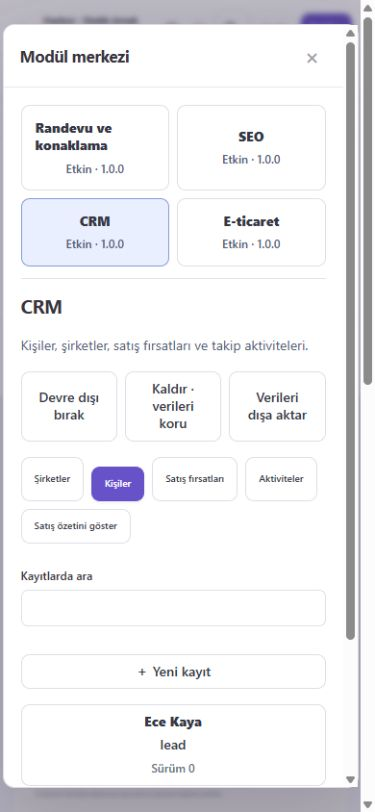
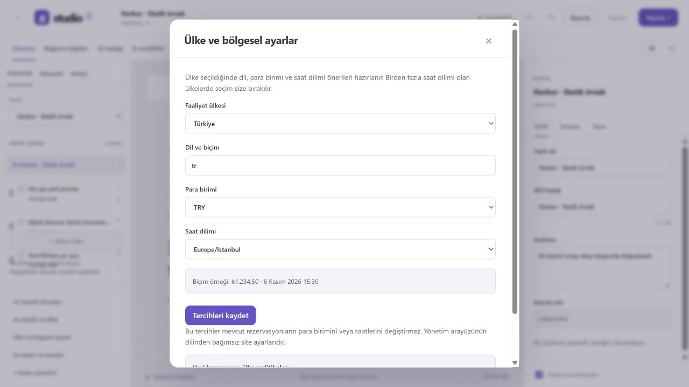
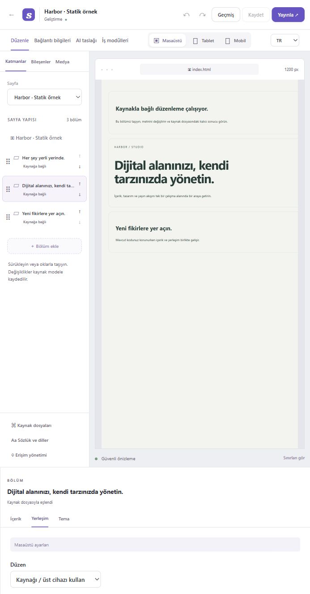

# V2 doğrulama raporu

## 2026-11-22 — AI iş geçişi politikası

Tam kontrol `20261122T195543-5f881ad1`, başlangıç `d6b124d`, çalışma ağacı
`0f12100fe7c706aa14777761520ee77113b4fb1548984ddf484fbf4f73e240a0`.
Çalışma sırasında değişiklik yok. 54 eski + 188 V2 = 242 uygulama testi geçti;
gerçek PostgreSQL etkin, uygulama skip'i yok. Yardımcı 15 başarılı/1 platform skip;
typecheck, build, check, paket, lisans, SBOM ve audit başarılı. Belgeler sonradan eklendi.
Üç yeni test saf iş durum geçişlerini sınar; kalıcı AI kuyruğu/PostgreSQL AI iş
deposu veya gerçek çalıştırıcı kabulü değildir. Model çalıştırılmadı.

## 2026-11-22 — AI sözleşmeleri ve çevrimdışı değerlendirme aracı

Tam kontrol `20261122T083512-60e2b600`; başlangıç commit'i `06df9f3`, çalışma ağacı
`777e2461213114a6a0d9b17837521b4df3ffee4b772cc766abbc7879e2b50236`.
Çalışma sırasında dosya değişmedi. 54 eski + 185 V2 = 239 uygulama testi geçti;
uygulama skip'i yok ve gerçek PostgreSQL etkin. Yardımcı 15 başarılı/1 platform
skip; typecheck, build, check, paket tüketicileri, lisans, SBOM ve audit geçti.
Bu rapor ve devir notu testten sonra güncellendi; çalışan kod değişmedi.

Altı yeni regresyon; sürümlü katı iş/sonuç şeması, kaynak/iş/hedef/bütçe/kanıt
eşleşmesi, review-only sınırı, sentetik veri ayrımı, eksik/yanlış/yinelenen cevaplar
ve gerçek CLI dosya sınırı/hata mesajını kapsar. 60 geliştirme ve 20 ayrı sentetik
örnek sözleşme smoke testidir; model kurulmadı/çağrılmadı. Sentetik doğru cevaplarla
değerlendiricinin sınanması model başarısı, pentest veya dil kalite ölçümü değildir.
Yeni UI, sağlayıcı bağlantısı veya canlı CMS yazma yolu eklenmedi.

## 2026-11-22 — Görsel seçim, React prop bağlantıları ve ortak güvenlik sözleşmesi

Son tam kontrol: `20261122T081034-7dd9d7df`; başlangıç commit'i `abebb07`, çalışma
ağacı `a874ba0c13023bd3e29233788a4c1658374ea9bc447940b9c99268a2b447d888`.
Çalışma sırasında dosya değişmedi. 54 eski + 179 V2 = 233 uygulama testi geçti;
uygulama skip'i yok, gerçek PostgreSQL etkin. Yardımcı 15 başarılı/1 platform skip;
typecheck, build, check, bağımsız paket tüketicileri, lisans, SBOM ve audit geçti.
Bu rapor sonradan eklendi; çalışan kod değişmedi.

İlk denemede PostgreSQL testindeki eski audit kayıtları 500 kayıtlık sorgu dilimini
doldurdu. Teste ayrı şema/temizlik getirildi. Sonraki hosting testinde ikinci yayın
dosya taşıma aşamasında başarısız oldu; test verisi OneDrive çalışma dizininden
işletim sistemi geçici alanına taşındı. Üretim audit veya yayın davranışı bu test
izolasyon düzeltmeleri için değiştirilmedi; tam kontrol sonrasında geçti.

Gerçek `VisualSelection` React bileşeni yerel iki sayfalı fixture ile tarayıcıda
doğrulandı: tıklama/Enter seçimi, Space ile kaldırma, sayfa değişiminde seçimin
korunması. Bu, bütün import sihirbazının uçtan uca tarayıcı kabulü veya WCAG
sertifikası değildir. HTTP testinde yetki ve seçim endpoint'i; protokol testinde
kaynak/origin/channel/key denetimi ve ithal kodun temizliği doğrulanır.

React SDK fixture'ı güvenilir test bileşenini gerçekten derler/render eder;
kaydedilen alan değeri çıktıya yansır ve JSX kaynağı korunur. Müşteri bileşenleri
çalıştırılmaz. Bildirilmemiş framework/JSX dönüşümleri ve izole canlı derleme bekliyor.

Ortak kök SECURITY.md resolver ile src/v2 kapsamı için doğrulandı. Bu bir yeni
güvenlik taraması veya bağımsız onay değildir. README, teknik devir, özellik eksik
analizi ve görev listesi güncellendi. Gemma 4 / Qwen 3 / Qwen 3.8 model kartları
AI analiz planına eklendi; ağırlık indirme, model kurulumu ve benchmark yapılmadı.

## 2026-11-22 — Manuel kaynak DOM seçimi ve framework keşfi

Tam kontrol `20261121T220839-1bf321a5` (UTC kimliği); başlangıç commit'i `3e5471b`,
çalışma ağacı `66adcb507700434ad4fd31381b5f9a887fe31b19edb860e85fa2b64bc0f383f5`.
Çalışma sırasında dosya değişmedi. 54 eski + 177 V2 = 231 uygulama testi geçti;
uygulama skip'i yok, gerçek PostgreSQL etkin. Yardımcı 15 başarılı/1 skip;
typecheck, build, check, paket tüketicileri, lisans, SBOM ve audit başarılı.
Bu rapor testten sonra eklendi; çalışan kod değişmedi.

Dokuz odaklı alan/DOM testi; hash'e bağlı seçim, çakışan alanların dışlanması,
manuel alanın gerçek HTML kaynağına yazılması, export/yeniden import, manifest
kapsamı, aday/alan sınırları ve kod çalıştırmadan framework kanıtlarını doğrular.
HTTP kabulünde manuel seçim commit/restart sonrası korunur; sahte anahtar reddedilir
ve HTML içermeyen framework importunun hata ekranı için kanıt raporu saklanır.

Gerçek React bileşenleri yerel fixture ile tarayıcıda denendi: DOM yolunda arama,
Space ile seçim, filtre altında seçimin korunması, temizleme ve teknoloji uyarısı.
Bu, tüm import sihirbazının tarayıcı kabulü veya erişilebilirlik sertifikası değildir.
Manuel seçim desteklenen düz metin yapraklarının kaynak yol listesidir; görsel
sayfada tıklamayla seçim ve framework bileşen koduna otomatik geri yazma tamamlanmadı.
[Kapsam ve API](FIELD_MAPPING.md).

## 2026-11-21 — Bağlantı ve görsel öznitelik eşleştirmesi

Tam kontrol `20261121T165424-1d60e1d6`; başlangıç commit'i `9c9a156`, çalışma
ağacı `500d6da14aa8172adb4682b5824b508bd58569293c7fbdc69c3ac204b01e2e52`.
Çalışma sırasında dosya değişmedi. 54 eski + 174 V2 = 228 uygulama testi geçti;
uygulama skip'i yok, gerçek PostgreSQL etkin. Yardımcı 15 başarılı/1 skip;
typecheck, build, check, paket tüketicileri, lisans, SBOM ve audit başarılı.
Bu rapor testten sonra eklendi; çalışan kod değişmedi.

Alan eşleştirme paketindeki altı test; href, alt ve src marker/type sözleşmesi,
aynı görselde birleştirilen src/alt yamaları, alt dizindeki sayfa yolları, tırnak
içinde öznitelik benzeri metnin korunması, mevcut bağlantı biçiminin korunması,
export/yeniden import ve seçim kalıcılığını doğrular. Geçersiz URL/medya, sahte
marker/type ve bölümün 40 alan sınırı sınandı. Responsive/harici/dinamik görsel
kaynakları otomatik src eşleştirmesinin dışındadır; alt bağımsız kalabilir.
Bu dilimde yeni tarayıcı kabulü yapılmadı; mevcut alan editörü kullanıldı ve panel
derlendi. Canlı sağlayıcı veya dinamik framework kabulü iddia edilmez.
[Kapsam](FIELD_MAPPING.md).

## 2026-11-21 — İşaretsiz HTML alan keşfi ve seçim

Tam kontrol `20261121T164311-b39b1d17`; başlangıç commit'i `8d3d4f0`, çalışma
ağacı `27417b8f2aa61008c9220022d90ed69725d6d5ee402f4ad311141287054f8b2b`.
Çalışma sırasında dosya değişmedi. 54 eski + 172 V2 = 226 uygulama testi geçti;
uygulama skip'i yok, gerçek PostgreSQL etkin. Yardımcı 15 başarılı/1 skip;
typecheck, build, check, paket tüketicileri, lisans, SBOM ve audit başarılı.
Bu doğrulama kaydı testten sonra eklendi; çalışan kod değiştirilmedi.

Dört yeni test; doğrudan/iç içe işaretsiz metin, aynı etiketli alanlar, kalıcı
kimlikler, kaynak yazımı, seçim dışı HTML'nin korunması, boş/hatalı seçim,
export/yeniden import, eski hash reddi, CSRF, tek commit ve restart kalıcılığını
doğrular. Gerçek React seçim bileşeni yerel örneklerle tarayıcıda kontrol edildi:
tekil seçim, tümünü seç/temizle, Space ile checkbox ve HTML örneğinin metin gösterimi.
Bu kontrol tam import sihirbazının tarayıcı kabulü veya erişilebilirlik sertifikası
değildir; import uçtan uca akışı gerçek HTTP testindedir.

Önceki tam denemede hosting ajanının ilk yayını bir kez 502 döndü; staging
dosyaları oluştu fakat release dizinine geçmedi. Aynı beş hosting testi ayrı
çalıştırmada ve son tam pakette geçti. Kök neden doğrulanmadı; tekrarlanabilir
bir kaynak eşleştirme hatası bulunmadı. Bu durum başarılı son koşumdan ayrı kaydedildi.
[Kapsam ve API uyumluluğu](FIELD_MAPPING.md).

## 2026-11-21 — Hosting bağlantıları ve statik dağıtım ajanı

Tam kontrol `20261121T162417-331a7c07`; başlangıç commit'i `21df0bf`, çalışma
ağacı `ba630c30a658c51bf36e34fe007f170e44403dee89a737f672e4a2e9ef672e6a`.
Çalışma sırasında dosya değişmedi. 54 eski + 168 V2 = 222 uygulama testi geçti;
uygulama testlerinde skip yok, gerçek PostgreSQL etkin. Yardımcı testleri 15
başarılı ve 1 skip. Typecheck, build, check, paket tüketicileri, lisans, SBOM ve
audit başarılı. Görev listesi ve bu rapor testten sonra güncellendi.

Beş hosting testi; ZIP ve sağlayıcı kimliği doğrulaması, Cloudflare branch/commit
uyuşmazlığı, şifreli yapılandırma, CSRF/yetki/revision, restart, kayıp yanıt,
yeniden gönderim engeli ve HTTP sağlık durumunu kapsar. Self-hosted/Natro ajanı
gerçek yerel HTTP ve dosya sistemiyle; yetkisiz erişim, digest, idempotency,
If-Match çatışması, yeniden başlatma ve eski sürüm durumu için test edildi.

Gerçek React paneli yerel fixture API ile kontrol edildi: bekleyen → inceleme →
başarılı durumları, klavyeyle durum sorgulama, kaydetme hatasında girdilerin
korunması ve Natro VPS/VDS alanları. Dar ekran görüntüsü sınırlı görsel kontroldür;
kapsamlı mobil/erişilebilirlik kabulü değildir. Canlı sağlayıcı hesapları, gerçek
TLS reverse proxy ve Natro paylaşımlı FTP hosting test edilmedi. Cloudflare/Netlify
testleri fixture kullanır. [Kapsam, kurulum ve sınırlamalar](HOSTING.md).

## 2026-11-21 — GitHub geri yazma ve kalıcı yayın akışı

Tam kontrol `20261121T071944-56b9fcdc`; başlangıç commit'i `35ce7b4`, çalışma
ağacı `28495e8428b28f28d8631f6370c7d978bcd2ae2d681f446ec86c41987e40438d`.
Çalışma sırasında dosya değişmedi. 54 eski + 163 V2 = 217 uygulama testi geçti;
gerçek PostgreSQL etkin, uygulama testlerinde skip yok. Yardımcı 15 başarılı,
Windows symlink yetkisi nedeniyle 1 skip. Typecheck, build, check, paket tüketicileri,
lisans, SBOM ve npm audit başarılı. Görev listesi ve bu rapor testten sonra güncellendi.

Altı GitHub testi; Git nesneleri, değişen dosyalar, ikili içerik, dosya modu, çatışma,
yol sınırları, yetki iptali, yanıt kaybı, HTTP/CSRF, restart ve aynı commit ile
uzlaştırmayı doğrular. Gerçek React panelinde hazırlık, hata gösterimi ve Enter ile
yeniden kontrol akışı yerel fixture üzerinde denendi. Canlı GitHub kabulü, hosting
dağıtımı veya kapsamlı erişilebilirlik sertifikasyonu iddia edilmez.
[Sözleşme, kullanım ve sınırlar](GITHUB_PUBLICATION.md).

## 2026-11-21 — Asenkron rezervasyon ve ödeme depolaması

Tam kontrol `20261120T224246-c34e220f`, başlangıç commit'i `a2f823a`, çalışma
ağacı `81b4ed0f49dc39a76658d7606952af6fd0cb91fb1d185bea2262c394c01db054`.
Çalışma sırasında dosya değişmedi. 54 eski + 156 V2 = 210 uygulama testi geçti;
gerçek PostgreSQL etkin ve uygulama testlerinde skip yok. Yardımcı testleri
15 başarılı, Windows symlink yetkisi nedeniyle 1 skip. Typecheck, build, check,
paket tüketicileri, lisans, SBOM ve npm audit başarılı. Ayrı `test:postgres`
çalıştırması 36/36 geçti. Sonrasında eklenen eşlenik SQLite/WAL yedek regresyonu
ayrıca çalıştırıldı: yedekleme dosyasındaki iki test de geçti. Bu ekleme üretim
kodunu değiştirmedi.

Kapasite yarışı, idempotency, atomik audit, ödeme ağı sırasında SQL kilidinin
serbest olması, eşzamanlı doğrulamada tek onay, geç ödeme incelemesi, eski
verilerin taşınması ve yeniden başlatma doğrulandı. Operasyonel depolama gerçek
SQLite/PostgreSQL üzerinde çalışır; tüm CMS'nin PostgreSQL'e geçtiği veya canlı
ödeme sağlayıcısı kabulünün yapıldığı iddia edilmez. Varsayılan yerel kurulum
üç SQLite veritabanı kullanır. [Tasarım ve geçiş](OPERATION_STORAGE.md).

## 2026-11-20 — Asenkron bağlantılar ve panel geçişi

Varsayılan V2 panel API 2 çalıştırıcısına taşındı. Rezervasyon ve SEO portları,
asenkron rezervasyon–CRM teslimatları, kalıcı ilişki koruması, atomik audit yazımı
ve mevcut audit sorgu/export deposuna idempotent aktarım eklendi. Eski kayıtlar,
kimlikler, revision değerleri, bağlantılar ve bekleyen teslimatlar yerel açılış
geçişinde korunur. Yeniden başlatma, eski yazıcı reddi ve kayıp hedef veritabanı
senaryoları test edildi. [Sınırlar ve geri dönüş](ASYNC_MODULES.md).

Tam kontrol: `20261120T163910-13dc88a4`, başlangıç commit'i `a19c114`, çalışma
ağacı `cd58bae819c963bb9acd3f845bb6724d3aa66b0f9375de567c2296316dbdabcd`.
Çalışma sırasında dosya değişmedi. 54 eski + 146 V2 = 200 uygulama testi geçti;
gerçek PostgreSQL grupları etkin, uygulama testlerinde skip yok. Yardımcıda
15 başarılı test ve Windows symlink yetkisine bağlı 1 skip var. Typecheck, build,
check, sekiz paket tüketicisi, lisans envanteri, SBOM ve npm audit başarılı.
Bu rapor paragrafı ve yerel checkpoint testten sonra eklendi; çalışan kod değişmedi.

PostgreSQL 17.7 gerçek loopback test sunucusudur. Booking operasyonel motoru ve
SEO içerik otoritesi bu kabulde SQLite/yerel portlardır; tüm CMS PostgreSQL'e
geçmiş değildir. Dağıtılmış transaction veya yeni canlı ödeme sağlayıcısı kabulü
iddia edilmez. Üretim verisi taşınmadı; uzak CI çalışması doğrulanmadı.

## 2026-11-19 — Asenkron modül kaydı ve gerçek PostgreSQL

API 2 AsyncModuleHost, CRM/e-ticaret portları, atomik yaşam döngüsü/olay yazımı
ve v1 export'tan kayıpsız kayıt aktarımı eklendi. Aynı kabul paketi SQLite ve
Docker PostgreSQL 17.7 üzerinde 18/18 geçti; fixture sunucusu kullanılmadı.
Yerel test verisi ve loopback 55432 kullanıldı. pg 8.23.1 geliştirme bağımlılığı,
geçişli lisans bildirimleri ve ayrı PostgreSQL CI işi eklendi.
Paket tüketici testi asenkron giriş noktalarını da kullanır.

Bu sonuç uzak CI çalışmasının başarı iddiası değildir. Varsayılan uygulama API 1
bileşiminde kaldı; canlı veri taşınmadı. Booking/SEO servisleri, entegrasyon teslimi
ve audit yakalama portları tamamlanmadan genel uygulama PostgreSQL'e geçmiş sayılmaz.
[Sözleşme, migration adımları ve sınırlar](ASYNC_MODULES.md).

## 2026-11-17 — Depolama sözleşmesi ve modül güven politikası

`module-core/storage` asenkron işlem sözleşmesi, ayrı SQLite bağlantısı ve
enjekte edilen pool ile PostgreSQL uygulaması eklendi. Yedi odaklı sözleşme
testi başarılı. Paket tüketicisine yeni alt yolların gerçek tarball testi eklendi.
`security.moduleTrustPolicy` uygulamadan modül/entegrasyon kayıt kontrolüne geçer;
reviewed-only yükleyici, onaysız paketin loader'ını çalıştırmaz.

Mevcut SDK v1, uygulama tabloları ve audit trigger'ları senkron SQLite yolundadır.
Gerçek PostgreSQL sunucusu testi yapılmadı: yerel Docker motoru çalışmıyor.
Tam profil sonuçları `.dev-assist` altında tutulur. Kapsam ve sonraki geçiş
kapıları [depoma ve güven sözleşmesinde](STORAGE_AND_TRUST.md) açıklanmıştır.

## 2026-11-11 — Bağımsız loglama modülü

`@loft-studio/audit` 0.1.0 (şema 1) ve Loft bağlantısı eklendi. HTTP başlangıç/
sonuç/iptal kayıtları; atomik DB değişiklik farkları; doğrulanmış kullanıcı/AI,
IP, istemci bilgisi, hedef kimliği ve istek korelasyonu; kapsam bazlı okuma ile
ayrı export yetkisi; filtreli panel ve tam JSON/CSV aktarımı çalışır.
[Kullanım, yetkiler ve işletim sınırları](AUDIT.md).

- Loglama regresyonları: L01–L14. Gerçek HTTP/SQLite, eşzamanlılık, rollback,
  yeniden açılış/şema uyumu, maskeleme, scope izolasyonu, export ve kopma senaryoları.
- Mevcut 54 eski sürüm testi ile v2 paketi ve sekiz paketlik bağımsız tüketici
  doğrulaması teslim kapılarıdır. Tam kontrol sonuçları yerel `.dev-assist/runs/`
  raporlarında commit ve çalışma dosyası parmak iziyle tutulur.
- Typecheck, build, check, licenses, SBOM ve bilinen açık taraması tam profile
  dahildir. Yeni üçüncü taraf bağımlılığı eklenmedi.
- 10 Kasım tarayıcı doğrulaması ayrı fixture hesabı/veritabanında yapıldı:
  site/işlem filtresi, Enter ile ayrıntı açma, eski/yeni/aktör/IP gösterimi,
  gerçek JSON indirme; 390×844 mobil görünümde sayfa ve tablo taşması yok.
  Mobil tablo 291 px kapsayıcıya sığdı. Kontrol edilen konsolda hata yoktu.
- [Ekran görüntüsü](audit-logging.jpg) sentetik test verisidir. Canlı kullanıcı
  verisinde migration/deployment yapılmadı; uzak CI sonucu bu yerel rapordan
  çıkarılamaz. Kod/GitHub eşitliği ayrıca commit üzerinden denetlenmelidir.

Makine bilgileri istemci beyanıdır; donanım kimliği değildir. Eski istekler
geriye dönük oluşturulmaz; gizli/binary/büyük değerler maskelenir veya açıkça
atlanır. Harici WORM/kriptografik log arşivi ve otomatik retention silme yoktur.

## 2026-11-10 — Yerel geliştirme yardımcısı

Codex masaüstü sohbetinden çağrılabilen, standart kütüphane kullanan Python
yardımcısı ve Node başlatıcısı eklendi. Proje özeti, sınırlı bağlam seçimi,
sabit test profilleri, kısa sonuç raporu ve commit/çalışma dosyalarına bağlı
checkpoint sağlanır. [Komutlar ve sınırlar](LOCAL_DEVELOPMENT.md).

- Yardımcı regresyonları: 16 senaryo; yerel Windows'ta 15 geçti, symlink
  oluşturma yetkisi gerektiren 1 senaryo açıkça skip edildi.
- Gerçek Loft deposunda status ve dosya/satır seçimi Python üzerinden çalıştı.
- Full profil üzerinden 54 eski sürüm + 98 v2 testi, bağımsız paket testleri,
  typecheck, build, check, licenses, sbom ve audit başarılı çalıştı.
- Node TAP/spec ve Python unittest rapor biçimleri; başarısız süreç,
  zaman aşımı, başlatma hatası, log sınırı, sır maskeleme ve eski kanıt tespiti
  regresyon kapsamındadır. Testler ayrı geçici depolar/veriler kullanır.
- CI'a Windows/Linux yardımcı test adımı eklendi; bu kayıt yerel doğrulamadır,
  yeni değişikliklerin uzak CI'da geçtiğini veya yayınlandığını belirtmez.

Yardımcı LLM çağırmaz; tasarruf yüzdesi ölçülmedi. Genel semantik kod araması,
tam bağımlılık analizi, uzak sohbet köprüsü veya kusursuz sır tespiti sağlamaz.

## 2026-11-10 — İsteğe bağlı modül iletişimi ve rezervasyon–CRM

İlk iletişim dilimi tamamlandı: sürümlü iş olayları, kalıcı yerel teslim ve
yeniden deneme, ayrı booking-crm paketi, CRM kişi ekranına koşullu görünüm,
açık kişi bağlantısı ve idempotent rezervasyon hareketleri.
[Kullanım, mimari ve sınırlar](INTEGRATIONS.md).

| Kontrol | Gözlenen sonuç |
| --- | --- |
| npm test | 54/54 geçti |
| npm run test:v2 | 98/98 geçti; toplam 152 ayrı test, skip/iptal yok |
| npm run typecheck | Başarılı |
| npm run build | Başarılı; editör ve ortak şemalar derlendi |
| npm run check | Sözdizimi, 200 vendor dosyası, 11 dil ve 286 alan/dil doğrulandı |
| npm run test:packages | Yedi paket temiz tüketicide çalıştı; bağımsız booking–CRM teslimi/kişi bağlantısı ve harici SDK modülü dahil |
| npm run licenses | 120 üçüncü taraf kilitli kayıt, inceleme bekleyen 0 |
| npm run sbom | Yedi birinci taraf paket dahil 127 bileşen; CycloneDX üretildi |
| npm audit --audit-level=moderate | Bildirilen açık 0 |
| git diff --check | Başarılı |

I01–I10 testleri iki modülün etkinlik birleşimlerini, site/izin sınırını,
body beklerken yetki iptalini, atomik olay ve handler rollback'ini, diskten
yeniden açılışı, tekrar teslimi, eski olayın güncel durumu geriletmemesini,
eski unlink isteğinin yeni bağlantıyı silememesini, kapalı/bileşimden çıkarılmış
paketin referans korumasını, eski veriden baseline geçişini ve hatalı kaynaktan
yalıtımı kapsar. Kalıcı matris TESTING.md içine eklendi.

Tarayıcı kontrolü gerçek müşteri verisinden ayrı test-results veritabanında,
sahte Deniz Örnek kaydıyla yapıldı. CRM kişisini açma, rezervasyonu klavyeyle
bağlama, iki hareketin görünmesi, modül kapalıyken panelin bulunmaması ve
yeniden açıldığında aynı bağlantı/geçmişin dönmesi gözlendi. 390×844 görünümünde
panel clientWidth ve scrollWidth aynı (315 px); yatay taşma ve konsol hatası yok.
Geçici viewport ayarı geri alındı. Görsel kanıt: booking-crm-mobile.jpg.

Yeni üçüncü taraf bağımlılık/kopya kod eklenmedi. Ürün lisansı değiştirilmedi;
booking-crm private birinci taraf paketidir. Testler gerçek ödeme/CRM sağlayıcı
hesaplarıyla yapılmadı. Ödeme doğrulamasının rezervasyon durumuna etkisi
yakalanır; ayrı tahsilat/iade zaman çizelgesi, otomatik kişi birleştirme,
bildirim/iş otomasyonu, genel entegrasyon şema migration API'si ve hosted worker
henüz bu teslimde yoktur. Canlı veri geçişi yapılmadı. Bu rapor yerel doğrulamayı
kaydeder; uzak depo eşitliği ve CI sonuçları ilgili Git commit'i üzerinden izlenir.

## 2026-11-09 — Dokuz code review bulgusunun düzeltmesi

R01–R09 düzeltildi. Kalıcı kabul matrisi ve güncellenmiş geliştirme/CI
prosedürü [TESTING.md](TESTING.md) belgesindedir. İlk 14 regresyon testi
düzeltmeden önce ilgili ürün hataları nedeniyle başarısız oldu, düzeltmelerden
sonra geçti. Body okunurken rezervasyon alımının kapanması için eklenen
15. test de önce hatayı gösterdi; güncel durum denetimiyle düzeltildi.

| Kontrol | Gözlenen sonuç |
| --- | --- |
| `npm run test:review` | 15/15 geçti; dokuz bulgu ve bekleyen işlem kapanışı |
| `npm test` | 54/54 geçti; son operasyon route değişikliğinden sonra ilgili 21 HTTP/özellik testi ayrıca yeniden geçti |
| `npm run test:v2` | 88/88 geçti; toplam 142 ayrı test, skip/iptal yok |
| `npm run test:packages` | Altı tarball temiz tüketicide geçti; SDK harici modülü ve ödeme tablosu olmadan randevu oluşturma/taşıma/takvim/iptal akışı |
| `npm run typecheck`, `build`, `check` | Başarılı; 200 kaynak hash'i, 11 dil ve 286 alan/dil korundu |
| `npm run licenses` | 120 kilitli üçüncü taraf bağımlılık; inceleme bekleyen 0 |
| `npm run sbom` | CycloneDX 1.5, 126 kilitli bileşen |
| `npm audit --json` | 2026-11-09: bildirilen açık 0 |

Sır dosyası adı politikası import, snapshot doğrulama ve şifreli yedek
işleminde ortaklaştırıldı. Müşteri iptal yanıtı publicView alanlarıyla
sınırlandı. Operasyon yetkisi body okumasından sonra yeniden denetleniyor;
import commit güncel iş durumunu aynı yazma işlemi içinde okuyor.

Randevu motoru ödeme tablosuna doğrudan bağımlı değil; ödeme kilidi uygulama
tarafından enjekte ediliyor ve mevcut Stripe HTTP testi kilidin çalışmasını
doğruluyor. Modül kapatma yeni işleri engellerken token ile geçmiş erişimi,
iptal ve mevcut ödeme doğrulamasını koruyor. Kapalı katalogda yeni checkout
formu da gösterilmiyor. Aynı istek kimliği farklı rezervasyon içeriğiyle
yeniden kullanılamıyor. Alt dizindeki statik/SDK sayfalarının medya yolları
gerçek export konumuna göre hesaplanıyor. SDK ve arayüzde sıfır değerli
maxLength/maxItems sınırları korunuyor.

Veri geçişi yalnızca booking_requests.fingerprint kolonu ekler. Eski
özetsiz istekler yeniden gönderilirse 409 döner; mevcut rezervasyonlar
silinmez. Geri dönüş ve daha önce import edilmiş sır dosyaları için
[geçiş notlarını](MIGRATION.md) uygulayın. Üretim verisine bu çalışma
sırasında geçiş uygulanmadı.

Sonuçlar yerel Windows/Node 24.13.0 doğrulamasıdır. Build, paket tüketici ve
SBOM komutları Windows sandbox alt süreç kısıtı (EPERM) nedeniyle izinli
çalıştırmayla tamamlandı. CI yapılandırması Ubuntu ve Windows'ta aynı
regresyon/paket kapılarını çalıştıracak şekilde güncellendi; bu kayıt uzak
CI çalışması veya yayın kanıtı değildir. Ödeme sağlayıcıları kontrollü
yanıtlarla test edildi; canlı sağlayıcı veya yeni tarayıcı kabul testi
yapıldığı iddia edilmez.

## 2026-11-09 — Modüler çekirdek, SDK ve dört iş paketi

`v2` dalında altı yerel npm workspace paketi eklendi: SDK, module-core,
booking, SEO, CRM ve commerce. Mevcut rezervasyon motoru bağımsız pakete
taşındı; eski veri tabloları ve çağrılar uyumluluk katmanıyla korunuyor.
Paket sözleşmesi, geliştirici akışı ve sınırlar [MODULES.md](MODULES.md)
belgesindedir. Bu sonuçlar yerel doğrulamadır; bu değişikliklerin uzak CI
çalışması veya npm yayını olarak değerlendirilmemelidir.

| Kontrol | Gözlenen sonuç |
| --- | --- |
| `npm test` | 54/54 geçti |
| `npm run test:v2` | 73/73 geçti; toplam 127 regresyon/sözleşme testi |
| `npm run test:packages` | Altı tarball temiz tüketici projesine kuruldu; harici SDK modülü uygulama kaynaklarına erişmeden çalıştı |
| `npm run typecheck`, `build`, `check` | Başarılı; 200 kaynak hash'i, 11 dil, 286 alan/dil korundu |
| `npm run licenses` | 120 kilitli üçüncü taraf bağımlılık, 95 kurulu paket; inceleme bekleyen 0 |
| `npm run sbom` | CycloneDX 1.5; kilitli 126 bileşen, altı birinci taraf paket dahil |
| `npm audit --json` | 2026-11-09: bildirilen açık 0; güvenlik garantisi değildir |

Yeni test kanıtları: yetki/kurum sınırları, ortak alan doğrulaması, tekillik,
ilişki ve sürüm çakışmaları; paket bağımlılıkları ve sıfır ana sürümlü
bağımlı paketi kapatma koruması; veri kaybetmeden kapatma/kaldırma ve tekrar
kurma; atomik veri geçişi geri dönüşü; salt okunur komuttan yazmanın reddi;
eşzamanlı son stok satışı, sipariş tekrarı ve iptalinde tek stok iadesi;
rezervasyon isteği tekrarında aynı kaydın korunması; SEO değişikliğinin gerçek
kaynağa ve yayın ZIP'ine yansıması; HTTP/CSRF ve yeniden açılış sonrası kalıcılık.

Tarayıcıda ayrı QA hesabı/veritabanıyla CRM kişisi oluşturuldu. İki adet ürün
içeren sipariş kaydedildi, sunucu toplamı 50000 TRY alt birimi ve stok 8→6
olarak görüldü. 390×844 görünümde modül penceresi yatay taşmadı; konsol
hata kaydı boştu. Tam erişilebilirlik veya penetrasyon denetimi yapılmadı.

E-ticaret bu aşamada yönetici siparişleri içindir; ziyaretçi sepeti, canlı
tahsilat, vergi/kargo/iade motoru yoktur. SEO dosyaları indirilip ayrıca
yayınlanır. CRM kampanya veya dış servis eşitlemesi yapmaz. Paketler güvenilir
sunucu kodudur; kötü niyetli eklentiler için sandbox değildir. Kesin ürün
lisansı ve ticari modül yetkilendirme sistemi bu dilimde değiştirilmedi.
Üçüncü taraf çalışma zamanı bağımlılığı veya üretim verisi eklenmedi.

## 2026-11-08 — Uzak CI ve anahtar dosyası adı sertleştirmesi

1ecad8d commit'i için [GitHub Actions çalışması](https://github.com/rasim21-maker/.studio/actions/runs/42454421094)
Windows ve Ubuntu'da bütün adımları başarıyla tamamladı: scriptsiz temiz kurulum,
typecheck/build/check, 54 baseline + 61 V2 testi, lisans, SBOM ve audit.
Her iki işletim sisteminin dependency evidence artifact'ı üretildi.

Son incelemede STUDIO-KEY / .ENV gibi harf büyüklüğü farklı anahtar dosyaları da
şifrelenmeyen veri parçasından dışlandı; anahtar isim çakışmaları reddediliyor.
Bu ek regresyonla yerel V2 paketi **62/62** geçti; toplam kapsam **116** test.
Son düzeltmenin uzak CI sonucu, dalın Actions kaydından ayrıca izlenir.

## 2026-11-07 — Anahtar, AI, ülke tercihleri ve CI dilimi

54 baseline + 61 V2 testi başarılı: toplam **115**. İlk 80 testin tamamı korunur;
bu dilimde 15 test, önceki güvenlik diliminde 20 test eklenmiştir.

| Kontrol | Gözlenen sonuç |
|---|---|
| npm test | 54/54 geçti |
| npm run test:v2 | 61/61 geçti; son çalıştırma 2026-11-07 |
| npm run typecheck / build | Başarılı |
| npm run check | 200 kaynak hash'i, 11 dil ve 286 alan/dil doğrulandı |
| npm run licenses | 120 kilitli / 95 kurulu paket, inceleme bekleyen 0 |
| npm run sbom | CycloneDX 1.5, kilit dosyasındaki 120 bileşenin tamamı |
| npm kurulum audit'i | 2026-11-06: 0 bildirilen açık |
| Temiz scriptsiz kurulum | 2026-11-07: ayrı test klasöründe npm ci --ignore-scripts, 95 paket / 0 açık; esbuild 0.28.2 dönüşümü başarılı |
| GitHub Actions | 1ecad8d için 2026-11-08: Windows ve Ubuntu başarılı; yukarıdaki run bağlantısı |

Yeni kanıtlar: kuruma bağlı zarf şifreleme, wrapping anahtarı değiştirme
primitive'i, eski sırların okunması, büyük payload reddi; ayrı şifreli anahtar
yedeği/restore ve bozuk/karışık/eksik/büyük yedek reddi; siteye sınırlı AI anahtarı,
süre/iptal/üyelik kontrolü, yayın ve başka API'lere erişim reddi, kötü AI çıktısı,
insan onayıyla ortak save; ülke sözlüğü, IANA saat dilimi, revision ve tenant
kontrolü, operasyon tutar/tarihlerinin korunması.

Ayrı QA hesabı/veritabanında tarayıcı gözlemi: Türkiye → tr/TRY/Europe/Istanbul
önerisi, ABD → açık saat dilimi seçimi, başarılı bölgesel kayıt; örnek AI önerisi
farkı → insan onayı → editörde değişen açıklama → “Uygulandı” durumu.
390 px genişlikte öneri penceresi 370 px, iç scroll genişliği 353 px olarak
gözlendi ve onay eylemi çalıştı. Tam erişilebilirlik sertifikası iddia edilmez.

SBOM ilk çalıştırmada Tiptap'ın eksik @floating-ui/dom peer bağımlılığını buldu;
MIT lisanslı 1.8.0 sabitlenince SBOM geçti. Son sınır testinde bulunan rewrap
değişken gölgelemesi düzeltildi; bütün 61 V2 test tekrar geçti.

Üretim verisi, gerçek ödeme veya LLM sağlayıcısı kullanılmadı. Gerçek KMS,
toplu rotasyon, hosted altyapı/MFA, online yedek/PITR, kaynak üç yönlü birleştirme,
20 gerçek site korpusu ve otomatik ülke mevzuat motoru tamamlanmış değildir.
Ürün kararı açık çekirdek + isteğe bağlı ticari modüllerdir; kesin lisans
ve ticari entitlement sistemi bu dilimin tamamlanmış özelliği değildir.

## 2026-11-06 — Delta güvenlik dilimi

Mevcut 54 baseline + 26 V2 testin tamamı korundu. 20 yeni test eklendi; toplam 100 test başarılı:

| Kontrol | Sonuç |
| --- | --- |
| npm test | 54/54 geçti |
| npm run test:v2 | 46/46 geçti |
| npm run typecheck | Başarılı |
| npm run build | Başarılı; Windows sandbox esbuild alt sürecini engellediği için izinli ortamda tekrarlandı |
| npm run check | 200 vendor dosyası, 11 dil, 286 alan/dil doğrulandı |

Yeni kanıtlar: ZIP/doğrudan/Git import yollarında Unicode/case çakışması ve özgün dosya adı korunumu; kuyruk başlarken ve uzak istek çevresinde güncel yetki kontrolü; yetki iptalinde aktif isteği durdurma ve karantina sonucunu silme; şema/alan/kaynak uyumsuz geçmiş sürümünü geri yükleme veya yayın ZIP'i yoluyla kullanmayı reddetme; tarihsel pasif sözlük değerlerini koruma. Ağ fixture'ları gerçek safeRequest kodunda özel/metadata/karma DNS reddini, adres pinlemeyi, redirect reddini, yanıt boyutunu ve iptali doğrular.

Yeni bağımlılık yok; lockfile ve önceki lisans envanteri değişmedi. Bu dilimde lisans/audit taraması ve tarayıcı QA yeniden çalıştırılmadı. Ağ ve CMS testleri kontrollü taklit sağlayıcı kullanır; gerçek servis veya üretim verisi kullanılmadı.

Bu sonuçlar hosted SaaS, MFA/KMS, güvenli online anahtar yedeği, tam N-1 kod geri alma, script'li önizleme, üç yönlü kaynak birleştirme veya 20 gerçek site kabulünün tamamlandığı anlamına gelmez. [Delta tablosu](../delta-durum.md), [tehdit modeli](../security/threat-model.md) ve [izlenebilirlik](../traceability.md) kalanları gösterir.

## Önceki alfa doğrulaması

Tarih: 2026-11-05. Sürüm: `2.0.0-alpha.1`, ayrı `v2` dalı. Bu teslim ilk çalışan uçtan uca dilimdir; bütün ürün yol haritasının veya üretim SaaS hazırlığının tamamlandığı iddia edilmez.

## Otomatik kontroller

| Kontrol | Sonuç |
| --- | --- |
| Mevcut Loft regresyon testleri | 54/54 geçti |
| V2 adaptör / HTTP / güvenlik / rezervasyon / geçiş testleri | 26/26 geçti |
| TypeScript `typecheck` | Başarılı |
| Editör + ortak şema derlemesi | Başarılı |
| Kaynak bütünlüğü / sözdizimi | 200 vendor dosyasının SHA-256 değeri, 11 dil, 286 alan/dil doğrulandı |
| Değişmemiş Loft yayın regresyonu | 143 HTML dosyası ve statik dosyalar birebir korunuyor |
| Lisans envanteri | 118 kilitli kayıt, 93 kurulu paket, inceleme bekleyen kayıt 0 |
| npm audit | Bildirilen güvenlik açığı 0 |

V2 testleri statik HTML, bağımsız React SDK ve WordPress sözleşme fixture'ını aynı adaptör akışında çalıştırır. Ayrı React kaynağı esbuild ile derlenir; içerik ve responsive CSS çıktılarına bakılır. Dördüncü test adaptörü çekirdek site koşulu eklemeden kayıt edilir.

Doğrulanan önemli sınırlar: kalıcı bölüm/alan eşleştirmesi, export→import kimlik ve tasarım korunumu, kaynak tarafında değişmiş sidecar'ın reddi, başlık ve zengin metin HTML yapısı, aynı şemanın AI/manüel API kayıtlarına uygulanması, sözlük pasifleştirme, traversal/bozuk ZIP/bomba/case çakışması, özel ağ hedefleri, CSRF, kurumlar arası okuma/yazma engeli, izin iptalinin anında etkisi, sürüm yarışında bir 200/bir 409, değişmez yayın ZIP'i, import iptali, şifreli bağlantı anahtarlarının API/ZIP'e çıkmaması, sağlayıcı sürümü değişince koşullu yayın reddi, operasyonları etkilemeyen içerik geri alma ve kapasite yarışında çifte rezervasyonun engellenmesi.

Yedekleme testi veritabanı ve şifreleme anahtarlarının korunduğunu, mevcut yedek üstüne yazılmadığını ve kaynak içindeki hedefe izin verilmediğini doğrular. DST testi New York'ta bir saatlik ve Lord Howe'da yarım saatlik tekrar eden yerel saatleri belirsiz diye reddeder; kullanıcıya başka saat seçmesini söyler. Kaybolan ilkbahar saatleri de reddedilir.

## Tarayıcıda gözlenen akış

İzole `test-results/ui-preview` verisi ve sahte QA hesabı kullanıldı. Kullanıcının çalışan Loft veritabanına bağlanılmadı.

- Site bağlama → örnek statik site → kuru çalışma → kaydet → editör.
- Metin düzenleme, bölüm yukarı/aşağı taşıma, klavyeyle sürükle-bırak, geri alma ve otomatik kayıt; kaynak önizlemesinde aynı sıralama/metin.
- Masaüstü ve mobil boşluk ayarları. Önizlemenin gerçek CSS viewport genişliği masaüstünde 1200 px, mobilde 390 px; dar editöre sığması için ölçeklenir.
- 390×844 mobil ekranda yönetim arayüzünde yatay taşma yok; tarayıcı konsolunda hata görülmedi.
- Yeni sitenin iş modüllerini kurma, takvimde kapalı zaman oluşturma, başarılı kayıt sonrası etkinliği görme.
- İyzico/Stripe/PayPal ve veri sağlayıcıları anahtarsız **Kurulum gerekli** durumunda görünüyor.

## Tamamlanan kapsam

Yerel çok kurum/site erişim modeli; TypeScript çekirdek ve sürümlü manifest; adaptör kayıt defteri; import raporu ve onay sonrası atomik benimseme; kaynakta kalıcı metin/sıralama; görsel/HTML editörü; düz bölüm ağacı; cihaz düzeni, boşluk/hizalama, 12 tema/7 şablon; geçmiş ve geri alma; şema/sözlük/dil kontrolü; medya kabulü; AI JSON önerisinin fark ve doğrulama akışı; içerik sürümleri ve ZIP yayını; yeni siteler için genel katılımcılı rezervasyon, takvim ve üç ödeme sağlayıcısının yönetimi.

## Açık sınırlar ve doğrulanmayanlar

1. **Loft geçişi:** Eski konsol çalışır ve V2 çalışma alanından erişilir. Loft'un bütün sayfaları yeni V2 editöründe henüz yönetilmez; mevcut kayıtlar kopyalanıp ikinci bir yetkili kaynak oluşturulmamıştır.
2. **Site kapsamı:** Statik keşif sınırlı doğrudan bölümler/metinler içindir. Arbitrary React/Next/Vue bileşenleri, Gutenberg/page-builder ağaçları, yeni sayfa yaratma, iç içe bileşen bırakma ve özel kod yazma hazır değildir. Desteklenmeyen kod korunur ve dış geliştirme/import akışına yönlendirilir.
3. **Harici bağlantılar:** WordPress köprüsü sözleşmesi transport fixture'ıyla test edildi; gerçek WordPress eklentisi ve canlı erişim doğrulanmadı. GitHub import ve ref kontrolü uygulanmıştır; canlı özel depo kimlik bilgileriyle test yapılmadı. Git'e PR/commit geri yazma ve genel deployment/remote rollback yoktur. Uygulamanın kendi GitHub teslimi bu özelliklerden ayrıdır.
4. **Ödemeler/veri sağlayıcıları:** Sağlayıcı testleri kontrollü mock yanıtlarla çalışır. Gerçek Stripe/iyzico/PayPal tahsilatı, ticari veri erişimi ve gerçek webhook teslimatı doğrulanmadı. İade otomasyonu ve çift yönlü dış takvim eşitlemesi yoktur.
5. **Modülleri siteye yerleştirme:** İş modülleri ve ziyaretçi rezervasyon ekranı hazırdır. Genel V2 booking/gadget bölümlerinin canlı çıktı bağlantısı otomatik kurulmaz; yer tutucu bunu belirtir. Mevcut Loft bağlantısı korunur.
6. **Hosted altyapı:** SQLite, sınırlı JSON medya/snapshot depolama, bir uzak bağlantı/site ve tek süreçli sınırlı import kuyruğu kullanılır. PostgreSQL/RLS, nesne depolama, dış worker kuyruğu, izolasyonlu genel derleme ve uzun dönem saklama politikaları kurulmadı. Kesilen import başarısız iş olarak geri gelir; byte düzeyinde kaldığı yerden devam etmez.
7. **Doğrulama ve sözlük:** V2 içerik alanları ortak şemayı kullanır; mevcut iş modülü formları mevcut sunucu doğrulamalarını kullanır. Tam alan şeması tasarımcısı, tüm modüllerin tek şemadan form üretimi, yazım/terminoloji servisi ve import sözlük eşleştirme ekranı sonraki dilimdedir.
8. **Erişilebilirlik ve güvenlik:** Klavye alternatifleri, native modal odağı, hata durumları ve responsive görünüm denenmiştir. Tam WCAG 2.2 AA denetimi, ekran okuyucu matrisi veya penetrasyon testi yapılmamıştır. Medya denetimi imza/boyut üzerinden yapılır; antivirüs veya tam görsel decode garantisi değildir. IPv6 uzak hedefler ihtiyatlı olarak kapalıdır.
9. **AI:** Süreli/siteye sınırlı bearer erişimi ve insan onaylı öneri akışı eklendi. Bir LLM sağlayıcısı bağlanmadı. Eski JSON taslağındaki `actorType=ai` istemci beyanı olarak kalır; doğrulanmış credential/proposal olaylarından ayrı değerlendirilir.

Sonraki iş sırası [geçiş planında](MIGRATION.md) kayıtlıdır. Canlı sağlayıcı kapsamları, bağlandıktan sonra kendi kabul testleri tamamlanmadan destekleniyor diye genişletilmemelidir.
